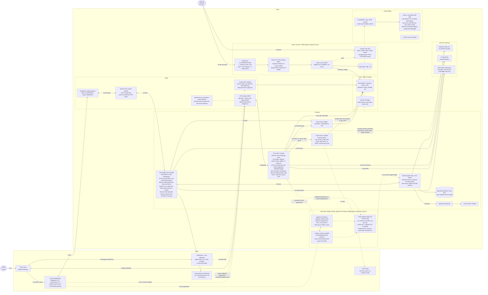

# OwlBank inbound voice blueprint: architecture

The Mermaid diagram and the flow steps below describe the solution. Detail is in the [solution guide](../solution-guide.md) and the [production guide](../production-guide.md).

**Exposure mode shown: no domain (the default).** The bridge WebSocket goes through CloudFront on its default `*.cloudfront.net` domain (WAF at CLOUDFRONT scope) and a CloudFront VPC origin to an internal ALB in private subnets, then to Fargate. API Gateway keeps its default `execute-api` endpoint. The custom-domain mode (API Gateway on the domain with `execute-api` off, public ALB with an ACM certificate) is shown as a dashed alternative and is the production recommendation.

**Agent loop.** The bridge runs the agent loop itself with Strands, calling Claude on Bedrock directly. AgentCore Memory and AgentCore Gateway are used from that loop; the AgentCore harness (a managed agent loop) is not used. Also part of the solution: latency masking, caller-silence handling, outcomes before ConversationRelay, early digits and the admin console (`OwlBankAdmin`). The silence watch follows ConversationRelay's speaker events.

**Bridge hosting shown: `bridgeHosting=fargate` (the default).** The second hosting, `bridgeHosting=agentcore`, runs the same bridge image in an AgentCore Runtime. Fargate stays the default for security (WAF and the Twilio signature on the WebSocket), and `agentcore` is an opt-in, for example for cheaper low-volume testing. It is drawn dashed, and its steps are in "Alternative hosting: AgentCore Runtime" below the flow steps.

**The draw.io diagram** (`owlbank-architecture.drawio`; the `.xml` has the same content) matches the Mermaid diagram below, except that it draws the AgentCore Runtime hosting as one dashed box (the Mermaid diagram also draws its warmer and arrows) and omits model-assisted slots; see the Mermaid diagram.

**Flow steps** (the numbers are on the arrows in the draw.io diagram)
1. **Incoming call.** The caller dials the OwlBank number. Twilio Voice sends a signed webhook.
2. **Edge.** API Gateway REST (its default `execute-api` endpoint, which is on in the no-domain mode) checks `X-Twilio-Signature` and Basic auth behind the regional WAF with logging and stage throttling, then invokes the front door Lambda. With a custom domain, `execute-api` is off.
3. **Opening and language.** The front door says "Welcome to OwlBank. This call may be recorded and transcribed for quality and training." in the English voice, then "Para español, oprima dos." in a Spanish voice (`languages.es-US.say.menuVoice`), and keeps the choice. A Spanish caller hears the welcome again in Spanish.
4. **ANI dip and trust check.** It looks the number up in `customers` (candidates only). `StirVerstat` is checked against the `ani_trust` policy, so an untrusted caller ID can't satisfy the ANI-match factor.
5. **Factors.** The slot engine resolves each answer in order: keypad; a deterministic parse of the spoken words; the digits inside a sentence (exactly one value of the right length, at most 2 words after it, no other collected slot's label); a choice's spoken names and aliases; the commands repeat, agent and cancel. What happens to an answer those leave open depends on the slot's **mode**, set in the policy table (`slot_resolution` and each `slot#<name>` item) and capped by the deploy-time `slotModeCeiling` (default `assisted`): in `deterministic` it is asked again, with no model call (no intent switches or corrections); in `assisted` one Haiku 5.5 call (the resolver, 2.5 s budget) proposes a value and a match type from the caller's **unredacted** words, and the value counts only if the caller said it (grounding, in code); the answer is then accepted, read back (only if the slot isn't sensitive), applied as a correction of an earlier answer in the flow, or handed to the AI as an intent switch; `generative` (opt-in, admin-only switch) may also word the card questions, under a structural check. Every sentence spoken otherwise is catalog text. Each slot's `sensitive`, `keypad_only` and `barge_in` settings come from its `slot#<name>` item; `acceptSpokenFactors` (on by default in every stage) makes every factor keypad-only when off. A sensitive slot's answer reaches the agent as `[<slot name>]`, is never read back, and is sealed into call state so every process scrubs it from its logs; a non-sensitive one (ZIP in the seed) reaches the agent unchanged. Spoken answers end after `speechTimeout` (3 s) of quiet, or as soon as a partial result holds the whole answer (`earlyDigits`: a REST call update ends the Gather). A verified factor followed by another gets "Got it." first. The front door then calls the auth service. For an untrusted ANI, a precheck reads the `risk` counter first.
6. **Token.** The auth service checks the factors against the policy, stores only the token hash, and counts untrusted failures in `risk` (short TTL).
7. **Connect.** The front door seals the call token with the token-sealing KMS key into call state, and returns TwiML that connects ConversationRelay with a one-time nonce in the URL. Later reconnects pass the call's `conversationId`, so Orchestrator keeps one conversation for the whole call (`reuseConversation`).
8. **Session.** ConversationRelay opens a WebSocket to the CloudFront default domain (WAF at CLOUDFRONT scope). A CloudFront VPC origin carries it to the internal ALB (HTTP inside AWS), and Fargate takes traffic only from the ALB. The bridge checks the signature against the public URL (`TWILIO_VOICE_PUBLIC_DOMAIN`) and consumes the nonce before it creates a session.
9. **AI turn.** The bridge runs the turn on its own Strands loop: Haiku 5.5 called directly on Bedrock, with adaptive reasoning and `drop_block` (`thinking` in `modelParams`), the inline tools and the approved Gateway tools only, and history in short-term AgentCore Memory under the actor `owlbank-voice-strands`, with the bank's local date and time added to the system prompt on every turn (`timezone`). Text the model writes in the same message as a tool call is never spoken. While the agent or a tool works, the bridge speaks scripted catalog phrases: an acknowledgement from a rotated pool if nothing has been said `masking.after_ms` after the caller's words (1 s by default), and a per-tool phrase from the tool's pool, filled with catalog words for its enumerated arguments ("Getting your savings balance now.") and scheduled after the tool's own delay; no tool waits for a phrase, and a balance hand-off prefetches the balance while its phrase plays. `PiiRedactor` (Comprehend detects, our code masks, fail closed) masks AI turns. Stored text goes back into prompts inside untrusted-content delimiters.
10. **Tool calls.** Customer-data tools are inline tools: the Strands loop pauses on the call and hands it to the bridge. The bridge unseals the token with KMS and invokes bank tools directly with the token and an idempotency key. Level-0 tools (hours, FAQ) go through AgentCore Gateway.
11. **Step-up.** The `authenticate` handoff ends the session (`end` + `handoffData`); a balance or confirmed tool refused only for the caller's level starts the step-up directly from the bridge, with no model call. Twilio calls the action URL and the front door asks the factors. After the SSN, the caller hears "Got it." at once while the auth service sends the code in the background (an asynchronous invoke, never retried) and writes `otp_send` to call state; the front door's redirect waits up to 2.5 s for it, then asks for the code. Verify sends the code only to a number on file for the verified customer (the calling number, or a number the caller keyed in), with a do-not-share warning. After a verified step-up the front door goes straight to the read-back or the balance. If the caller has no number on file or Verify can't deliver, the call escalates with `otp_unavailable`. A code sent to an untrusted ANI raises the `otp_sent_untrusted_ani` alarm.
12. **Confirmation.** For tools configured with `confirm`, the bridge hands off with validated arguments. For a payment the front door asks which card first if the AI's card isn't one the caller holds (the `card` slot), then reads the arguments back, card by name (correctable in the read-back), takes a yes or no (2 s speech timeout, `confirmSpeechTimeout`), then invokes bank tools. A balance read-out is spoken as the next ConversationRelay session's interruptible welcome greeting, so the caller can cut in; their words reach the agent as an ordinary caller turn right after the result. A payment or transfer outcome is spoken as plain `<Say>` before ConversationRelay connects, so it can't be cut off, and only "Anything else?" is the greeting. If the caller then says nothing, the bridge repeats the last message after 4 s (7 s after the opening greeting), up to twice, then escalates (`no_input`) or hangs up, as configured. The wait counts from the end of the agent's speech and pauses while the caller is speaking, using ConversationRelay's speaker events (`clientSpeaking`, `agentSpeaking`), so a caller who starts a long sentence late isn't cut off.
13. **Escalation.** `verification_risk` (untrusted-attempt cap or an untrusted login that would need a code before a token exists), `otp_unavailable` or a request for a person: the front door masks the summary, then speaks a briefing and hangs up by default, or with Flex returns `<Enqueue>`. With Flex, TaskRouter routes to Support EN, Support ES or Fraud.
14. **Screen pop (Flex only).** The Flex plugin reads the context API (Flex authorizer; read-only, redacted timeline from `segments` and `calls`).
15. **Admin console** (optional stack). An operator signs in through Cognito managed login and edits tool and masking settings and masking phrases. The site and its API share one CloudFront domain: `/api/*` goes to an API Gateway REST API with a Cognito authorizer on every method, which accepts only requests carrying CloudFront's secret `X-Origin-Verify` header. Its Lambda validates each edit with the bridge's own rules and writes the policy or catalog item and an audit entry in one transaction. Running bridges pick the change up within 60 s.

**Alternative hosting: AgentCore Runtime** (`bridgeHosting=agentcore`; `infra/README.md`, "Two bridge hostings"). Everything else (API Gateway and its WAF, the front door, the auth service, bank tools, KMS, DynamoDB, Memory, Gateway, Flex) is unchanged. What changes, by step:
- **3.** On a new call's `incoming` the front door starts the `runtime_warmer` Lambda (an asynchronous invoke). It calls `InvokeAgentRuntime` with `{"action": "prewarm"}` on the call's Runtime session (session ID = the CallSid), so the session is ready while the caller is in the language menu and verification. AgentCore keeps spare microVMs started, so a single call attaches to one and is warm anyway; the warmer matters for a burst beyond that pool, whose microVMs boot cold (several seconds, hidden by the IVR).
- **7.** Instead of `wss://<relay>/ws?n=<nonce>`, the front door mints a SigV4 pre-signed URL for the Runtime's `/ws`, valid at most 300 s, with credentials of a dedicated presign role. AgentCore passes no query parameters to the container, so the nonce goes in `<Parameter name="n">`.
- **8.** ConversationRelay connects to the AWS-owned AgentCore endpoint (no CloudFront, ALB or WAF), which checks the signature and forwards the socket to the call's microVM. There is no Twilio signature on this hop; the bridge checks the binding (the Runtime session-ID header, the `setup` CallSid and the `callSid` parameter are equal, and the process serves one session only), then consumes the nonce.
- **9 to 13.** The same, inside the microVM. A re-entry after a scripted step reaches the same microVM within the idle timeout (900 s by default, `agentcoreIdleTimeoutSeconds`); after it, a new microVM rebuilds the agent's history from Memory. Orchestrator's status callbacks go to a front-door route, `POST /voice/orchestrator` (WAF Basic challenge, Basic and signature checks), which acknowledges and logs them: no event is needed during a call.
- **End of the call.** The front door's status callback calls `StopRuntimeSession` once per call. At about 60 minutes AgentCore closes the WebSocket; the front door reconnects to the same session silently (up to 4 times per call).
- **Network.** VPC mode (default): the private subnets whose AZ ID AgentCore supports, egress on 443 only. Public mode (opt-in): no VPC. Leaving VPC mode, AgentCore's network interfaces can hold the Runtime's security group for hours (`infra/README.md`, "Deploy hazards").
- **Image.** The CDK doesn't build the bridge image on this hosting: every bridge change is a push to ECR and a Bridge deploy with the new digest.
- **Latency.** Expect a similar connect-to-first-word to Fargate; the production guide, "Hosting options for the bridge", says how to measure it.

**Legend**
- draw.io: red border is Twilio, orange border is AWS. Red arrows are Twilio calls and the voice path, dark arrows are service calls, grey arrows are data, key and model access. Dashed means optional, a callback or an alarm path.
- Mermaid: dashed arrows are optional, callback or alarm paths. Table access is shown once per component; the draw.io version places each table beside the component that uses it and lists the other users in the table's note.

- **No-domain compensating controls:** `execute-api` stays on, so every Twilio-facing route relies on the signature check, Basic auth, regional WAF and stage throttling. The ALB has no public address and accepts only the CloudFront VPC origin; Fargate accepts only the ALB. The CloudFront-to-ALB hop is HTTP. Use the custom-domain mode in production.

**Data and keys**
- DynamoDB tables: `customers`, `tokens`, `calls`, `segments`, `policy`, `catalog`, `risk` (only the auth service reaches `risk`), and with the admin console its audit table (only the `admin_api` Lambda reaches it, and that Lambda reaches only `policy`, `catalog` and the audit table). All use the customer-managed data key.
- KMS: the data CMK, and a dedicated token-sealing key that only the front-door role (Encrypt, Decrypt), the auth-service role (Encrypt) and the bridge task role (Decrypt) may use, with `call_sid` in the encryption context.
- Secrets Manager: Twilio API key, Twilio auth token, Basic auth. Created by CDK in the data stack. Secrets Manager generates the Basic auth password; the operator or the bank's pipeline writes the API key and auth token once after the deploy (`scripts/populate_secrets.py`, the console or the CLI). The runtime and the setup scripts only read them.

**Observability:** JSON logs correlated by `call_sid`, five saved Logs Insights queries, alarms through the encrypted SNS topic, X-Ray tracing, and an IAM Access Analyzer.

**Hosting the bridge.** Two hostings, chosen by `bridgeHosting`: ECS Fargate behind the ALB (`fargate`, the default; above), and the same bridge, with the same Strands loop, in an AgentCore Runtime (`agentcore`, an opt-in; "Alternative hosting: AgentCore Runtime" above; production guide, "Hosting options for the bridge"). An AgentCore Runtime there is only a host; it is not the AgentCore harness. A switch in either direction is one deploy of the Bridge, Compute and Api stacks, then `twilio_setup.py --phase post` (`infra/README.md`).

## Checks

Why the agent loop runs in the bridge and not in the AgentCore harness: production guide, "Why not the AgentCore harness?".

- `X-Twilio-Signature` and Basic auth on every HTTP endpoint Twilio calls; the `/ws` upgrade checks the signature and the one-time nonce. With `bridgeHosting=agentcore` the WebSocket has a SigV4 pre-signed URL (at most 300 s), the CallSid binding and the one-time nonce instead of the signature.
- The call-bound token on every customer-data tool; the model never sees it.
- A sensitive slot's value never reaches the agent (it gets `[<slot name>]`), transcripts, `handoffData` or logs (exact-value scrub), and is never read back. A factor that isn't flagged sensitive (ZIP in the seed) may reach the agent and is read back; production should flag every factor.
- **Factor digits do reach the slot resolver** in `assisted` and `generative`: the caller's words go unredacted to Haiku on Bedrock in the deployment's own account (US inference profile), so messy speech can be resolved. `deterministic` sends nothing, and with `slotModeCeiling=deterministic` the front door's role has no Bedrock permission. Preflight fails if Bedrock model-invocation logging delivers text in a Region the profile routes to, and an EventBridge rule alarms on a logging change (deployment Region only).
