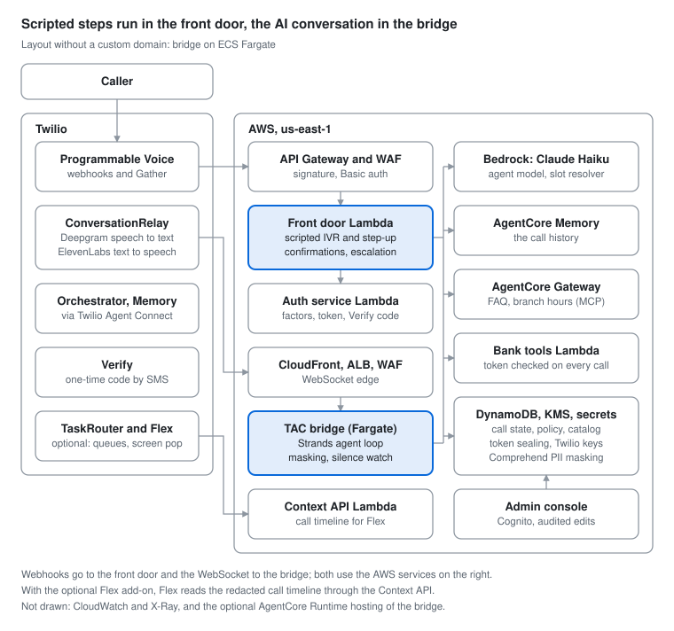

# OwlBank Inbound Voice AI on AWS: Solution Guide

This guide explains how the solution works and why it is built this way. The settings themselves are in [the production guide](production-guide.md).

## Contents

**The solution**

1. [Overview](#1-overview): what it is, the three key messages, status words
2. [Architecture](#2-architecture): the diagram, components, configuration stores
3. [A call from start to finish](#3-a-call-from-start-to-finish)

**Identity and tools**

4. [Identity, authentication and step-up](#4-identity-authentication-and-step-up)
5. [How tools check authorization, and why the AI never sees it](#5-how-tools-check-authorization-and-why-the-ai-never-sees-it)
6. [Tool types and how each works](#6-tool-types-and-how-each-works)
7. [Why inline tools: latency and control](#7-why-inline-tools-latency-and-control)

**The caller's experience**

8. [Scripted flows and slot modes](#8-scripted-flows-and-slot-modes-how-dynamic-each-answer-may-be)
9. [Speech: recognition, end of speech, barge-in and voices](#9-speech-recognition-end-of-speech-barge-in-and-voices)
10. [Latency masking](#10-latency-masking)
11. [Memory and personalization](#11-memory-and-personalization)
12. [Escalation to a human: queue, summary and screen pop](#12-escalation-to-a-human-queue-summary-and-screen-pop)

**Running it**

13. [Privacy and data protection](#13-privacy-and-data-protection)
14. [The admin console](#14-the-admin-console)
15. [Observability and evaluations](#15-observability-and-evaluations)
16. [Hosting options for the bridge](#16-hosting-options-for-the-bridge)
17. [Security controls](#17-security-controls)
18. [Deploying and adapting it to a customer](#18-deploying-and-adapting-it-to-a-customer)
19. [Failure handling](#19-failure-handling)
20. [Testing and quality](#20-testing-and-quality)
21. [The AI turn: streaming, failover and where the agent loop runs](#21-the-ai-turn-streaming-failover-and-where-the-agent-loop-runs)
22. [Known limits and extensions](#22-known-limits-and-extensions)
23. [Glossary](#23-glossary)

## 1. Overview

OwlBank is a reference build of an AI phone line for a fictional bank, running on Twilio and AWS. A caller dials a Twilio number, chooses English or Spanish, and proves who they are by keypad or speech before an AI agent can see any of their data. The agent answers questions, reads transactions, changes an address, and takes payments and transfers after a step-up. When it should, it hands the call off: by default the agent speaks a short briefing and the call ends, and with the optional Twilio Flex add-on the call goes to a person along with a summary and a screen pop.

It runs in your own AWS account and Twilio account. The data is fictional, and the back end is a mock bank.

### Three key messages

1. **Dynamic where it helps, deterministic where it must be.** The AI agent handles open conversation: questions, reasoning, picking the right action. Anything that must be exact runs as scripted steps in a deterministic front door, using the bank's approved wording: verification, step-up, balance read-outs, and the read-back and "yes" before money moves. How much the model may help even inside scripted questions is a per-slot setting, with a ceiling fixed at deploy time.
2. **Built for low latency.** Every design choice is weighed against what the caller hears: the agent loop runs in the bridge (about half the time of AgentCore's managed agent harness, which the blueprint does not use; section 21), customer-data tools are invoked directly rather than through a tool gateway, spoken digits end the prompt as soon as they are complete, and short scripted phrases fill the unavoidable waits.
3. **A starting point, not a finished product.** The blueprint shows the key parts of an inbound contact centre working together: the IVR front door, identity and step-up, an AI agent with tools, latency masking, escalation to humans with context, an admin console, privacy controls and observability. It is meant as an example and a base to customize into each customer's own solution: swap the mock bank for real systems, change the tools, policies, prompts and languages, and pick the settings that fit the customer's risk and compliance needs (section 18).

### Who this guide is for

Solution architects, engineers and reviewers. It explains the concepts; the repository holds the exact settings and procedures:

- `docs/production-guide.md`: every setting, its demo default, the production recommendation and the reason.
- `docs/runbook.md`: how to investigate a call from a CallSid, a time or a symptom.
- `infra/README.md`: the deploy steps.

### Status words used here

- **Built:** in the code and covered by automated tests (section 20). Anything not marked otherwise is built.
- **Documented, not built:** an option described for customers who need it.
- **Measured** figures are indications from small samples, not benchmarks. Each states the conditions it was measured under.

## 2. Architecture

The solution has two halves that the caller moves between during a call:

- **The front door** is a Lambda behind API Gateway that answers Twilio's voice webhooks with TwiML (Twilio's XML call instructions). It runs everything scripted: the greeting and language menu, verification, step-up, balance read-outs, payment confirmation and the transfer to a person.
- **The bridge** is a container that holds the ConversationRelay WebSocket while the caller talks to the AI. It runs the agent loop (Strands, calling Claude on Bedrock), executes customer-data tools, plays latency-masking phrases and watches for silence.

When the AI needs something scripted, the bridge ends the ConversationRelay session with a hand-off. Twilio calls the front door, which runs the step and connects the caller back to the AI, carrying the result with it. A call can make this trip several times.

The two highlighted boxes are the two halves of every call: the front door for scripted steps, the bridge for the AI conversation.

### Components

| Layer | Component | What it does |
| --- | --- | --- |
| Twilio | Programmable Voice | The phone number; signed webhooks to the front door; `<Gather>` for scripted questions |
| Twilio | ConversationRelay | Speech to text (Deepgram) and text to speech (ElevenLabs) for the AI conversation, over one WebSocket per AI segment |
| Twilio | Twilio Agent Connect (TAC) | The SDK in the bridge that speaks ConversationRelay and Orchestrator and gives access to Memory |
| Twilio | Conversation Orchestrator | Records the call as one conversation, linked to the customer's Memory profile |
| Twilio | Conversation Memory | The customer's profile and what earlier conversations left, recalled after verification (distinct from AgentCore Memory, section 11) |
| Twilio | Verify | The one-time code by SMS, sent only to a number on file for the verified customer: the calling number, or a number the caller keyed in |
| Twilio | TaskRouter and Flex (optional) | With Flex: queues (Support EN, Support ES, Fraud, Disputes), routing, and the agent desktop with the screen-pop plugin |
| AWS edge | API Gateway REST and WAF | Front door for every Twilio webhook: Basic-auth challenge, signature check, throttling |
| AWS edge | CloudFront, WAF and an internal ALB | Front door for the WebSocket (no-domain mode); a public ALB with a certificate in the custom-domain mode |
| AWS compute | `frontdoor` Lambda | The scripted IVR, slot engine, step-up, confirmations, deterministic tools, escalation |
| AWS compute | `auth_service` Lambda | Checks verification factors, issues and upgrades the call-bound token, sends the code, counts risk |
| AWS compute | `bank_tools` Lambda | The mock bank: balances, transactions, address change, payment, transfer. Validates the token on every call |
| AWS compute | TAC bridge (ECS Fargate) | The agent loop and the AI side of the call. Optional second hosting: AgentCore Runtime |
| AWS AI | Bedrock, Claude Haiku 5.5 | The agent's first-choice model (with failover to others, section 21), and the slot resolver for messy spoken answers |
| AWS AI | AgentCore Memory | Short-term memory: the call's conversation history, so any bridge task can resume a call |
| AWS AI | AgentCore Gateway and `level0_tools` | MCP tools that need no identity: FAQ and branch hours |
| AWS data | DynamoDB | Customers, tokens (hashes only), call state, the call journal, policy, prompt catalog, risk counters |
| AWS data | KMS, Secrets Manager | A customer-managed data key; a separate key that seals the call token; Twilio secrets |
| AWS data | Comprehend | Detects PII in AI turns and summaries, which the code then masks |
| AWS ops | `context_api` Lambda | Serves the redacted call timeline to the Flex plugin, behind a Flex token authorizer (serves data only with Flex; 503 otherwise) |
| AWS ops | Admin console | Cognito sign-in, CloudFront site and API to tune tools, masking, slots and redaction, with an audit log |
| AWS ops | CloudWatch, X-Ray | JSON logs keyed by CallSid, alarms, and optional OpenTelemetry traces and call metrics |

AgentCore appears in three separate roles: Memory (the call's history), Gateway (the level-0 tools) and, as an opt-in, Runtime (a host for the bridge, section 16). The managed AgentCore harness is not used.

### Two configuration stores, no redeploy

Most behavior lives in data, not code:

- **The policy table** holds the verification levels and factors, each tool's kind, minimum level and confirmation mode, the escalation queues and reasons, slot settings, masking timings and redaction. It is seeded from `data/policy.json`.
- **The prompt catalog** holds every sentence the system speaks itself, in en-US and es-US, plus the agent's system prompt. It is seeded from `data/prompt_catalog.json`.

Running components cache both for 60 seconds, so a change made in the admin console or by a reseed applies to the next turn of live calls within a minute.

### The CDK stacks

The AWS side is one CDK app (Python) with stacks for the network, data, compute (Lambdas), the bridge and its image, the API, and the optional admin console (`OwlBankAdmin`). cdk-nag and synth-time tests enforce the project's security rules, for example no `*` principals, no Lambda Function URLs, no public S3 and WAF on every Twilio-facing route.

## 3. A call from start to finish

This walk-through follows one caller who checks recent transactions and then pays a credit card bill. Each step names the part that runs it.

1. **The call arrives.** Twilio sends a signed webhook. API Gateway's WAF and the front door check the Basic credentials and the Twilio signature before anything else runs.
2. **Greeting and language.** The front door says "Welcome to OwlBank. This call may be recorded and transcribed for quality and training", then "Para español, oprima dos" in a Spanish voice. The opening greeting carries the recording and transcription notice, and the personalized greeting identifies the assistant as a virtual agent (wording is the deploying bank's to review; section 22). The menu is keypad only. A caller who presses 2 continues in Spanish (es-US); everyone else in English (en-US).
3. **Caller ID check.** The front door looks up the calling number among customers and reads Twilio's STIR/SHAKEN result (`StirVerstat`). A trusted match counts as one verification factor; an untrusted one doesn't. If the number matches no customer, or is withheld, the front door asks for the account's phone number instead (see "Caller ID is a factor only when it can be trusted").
4. **Verification.** The front door asks for the factors the first level needs (ZIP code with a trusted caller ID). The caller can type or say them. The auth service checks them and issues a **call-bound token** at level 1. The front door seals the token with KMS into call state.
5. **Connect to the AI.** The front door returns TwiML that connects ConversationRelay to the bridge, with a one-time nonce (a value that works once, so a replayed connection request is rejected). The bridge checks the Twilio signature and uses up the nonce, then greets the caller by first name.
6. **An AI turn with an inline tool.** The caller asks about recent savings activity. The agent calls `list_recent_transactions`, an **inline tool**: one the bridge runs itself (section 6). The bridge pauses the loop, unseals the token, invokes `bank_tools` directly, and returns the result to the model. If nothing has been said after 1 second, the caller hears a short scripted **masking phrase** (section 10) such as "One moment. Getting your recent savings transactions."
7. **A money move needs more.** The caller asks to pay $25 toward a credit card. `make_payment` needs level 3, and is confirmed by the bank's words. The bridge sees the level is too low and starts the step-up at once, without asking the model again (the **step-up shortcut**, section 4).
8. **Step-up in the front door.** The ConversationRelay session ends with a hand-off. The front door asks for the SSN last four, says "Got it" while the one-time code is texted in the background, and checks the code. The token is upgraded to level 3.
9. **Read-back and confirmation.** The front door reads the payment back from a catalog template (amount, card name and account) and asks for yes or no. Only a yes runs `make_payment`. The outcome and confirmation number are spoken as plain speech the caller can't cut off.
10. **Back to the AI.** The front door reconnects ConversationRelay to the same Orchestrator conversation. "Anything else?" is spoken as an interruptible greeting, and the payment result goes to the model as the answer to its original payment tool call. Every scripted step's result is handed back this way, so the model's history holds what the caller heard even though the front door said it. For example, after a checking balance read-out the caller can ask "and what about my savings?", and the agent understands it as another balance request.
11. **Escalation, if needed.** If the caller asks for a person, the agent calls `escalate` with a reason and a short summary. The front door masks the summary and revokes the token. Without Flex (the default) it reads a short briefing to the caller and ends the call (section 12); with Flex it returns `<Enqueue>` with task attributes. TaskRouter picks the queue, and the human agent who picks up the call in Flex sees a screen pop: the AI's summary of the conversation, the escalation reason, the caller's current verification level and language, and the tools already run. The caller doesn't have to repeat themselves.
12. **Call end.** The status callback revokes any remaining token. Call state and journal entries expire by TTL.

### Why the call leaves the AI and comes back

Each trip between the AI and the front door is a hand-off over ConversationRelay's `end` message and the `<Connect action>` callback. It costs a reconnect (on re-entry after a scripted step, connect to first word is 1.29 s p50 on Fargate; the production guide, section 1, has the table), and it is worth it because it gives scripted steps three guarantees:

- the words are the bank's approved text, not the model's;
- the model cannot skip, reword or fake the step;
- secrets the caller says or types (SSN, code) go to the front door, not to the AI.

The `reuseConversation` setting (section 11, "One conversation per call") keeps one Orchestrator conversation for the whole call, so a reconnect doesn't create a new conversation, which would add 4 to 15 seconds each time.

## 4. Identity, authentication and step-up

A phone caller hasn't signed in anywhere, so the call has to earn its identity. The solution does this with **levels**: each level is a set of verification factors, and each tool needs a minimum level.

### Levels and factors

| Level | Factors (seed) | What it unlocks (seed) |
| --- | --- | --- |
| 0 | None | FAQ, branch hours, general questions |
| 1 | Caller ID match + ZIP code | Balances, recent transactions |
| 2 | Level 1 + SSN last four | Address change |
| 3 | Level 2 + one-time code by SMS | Payments and transfers |

The levels, factors, lengths and retries are in the policy table, so a bank can change them without code changes. The attempt limits are in "Limits" below.

### Caller ID is a factor only when it can be trusted

Caller ID can be spoofed. The front door reads Twilio's STIR/SHAKEN attestation (`StirVerstat`). Only an accepted value (by default `TN-Validation-Passed-A`) makes the caller ID count as a factor. For an untrusted caller ID the caller is asked the next level's factors instead: ZIP **and** SSN last four for level 1.

Failed attempts from an untrusted caller ID never count toward the real customer's lockout, so a spoofer can't lock them out. They count toward a separate cap per candidate customer (3 an hour by default; see "Limits"). At the cap, the next untrusted call for that customer goes straight to the fraud queue before any factor is asked.

**When the caller ID finds no one.** If the calling number matches no customer, or is withheld, the front door asks "What is the phone number associated with your account?" before any factor. The caller types the ten digits or says them, and gets up to two tries. Spoken answers go through the same resolver as other digit answers, so "407, eh 544, what was it, 5555" is understood. The number is looked up with the same customer lookup as the caller ID. On a match, login goes on as for an untrusted caller ID: ZIP and SSN last four for level 1. With no match after two tries, or an answer that can't be understood, the call is handled as any other call with no match, and the wording doesn't say whether a number exists.

A keyed-in number is never trusted, because anyone can type any number. The untrusted factor set applies, whatever STIR/SHAKEN says and also when `on_untrusted` is `allow`, and the untrusted attempt cap counts failures. The number is kept sealed with the call's other sensitive answers until the call ends, and never appears in logs, the journal or the summary. Flex shows "Identified by a keyed-in number" on the task, never the digits.

The one-time code rules for a keyed-in number are under "The one-time code" below: only to a number on file for the customer, and only after ZIP and SSN last four (level 1) have passed, so knowing a customer's number can't trigger texts to them. The code proves the caller holds the phone on file, not that the line they are on is that phone.

The step is on by default. `ani_trust.ask_phone_on_no_match` in `data/policy.json` turns it off (the production guide, "Configuring caller-ID trust"); then a caller ID with no match goes straight to the no-match handling.

### The one-time code

The code is sent with Twilio Verify, only to the number the caller is calling from (on a call identified by a keyed-in number, that number), and only if that number is on file for the customer who has just verified. Otherwise no code is sent and the caller is transferred to a person (reason `otp_unavailable`). Texting another number raises consent questions the blueprint avoids by default. The code is never sent before the caller has passed login. A code sent on a call with an untrusted caller ID raises an alarm for review.

To save time, the front door says "Got it" right after the SSN and sends the code in the background, then asks for it.

### The call-bound token

After verification, the auth service issues an opaque random token (`secrets.token_urlsafe(32)`):

- **Only its SHA-256 hash is stored**, with the call, the customer, the level, the expiry time and a revoked flag.
- **It is bound to one call.** It validates only for the CallSid it was issued on.
- **It is sealed in transit.** The front door encrypts the raw token with a dedicated KMS key, using the CallSid as encryption context, and stores it in call state. The bridge unseals it in memory for each tool call. A sealed value copied to another call won't decrypt.
- **It is short-lived.** It is revoked on escalation, on a hang-up for no input, and at call end, with a TTL as backstop.

### Step-up during the AI conversation

When the caller asks for something above their level, the call goes up a level without starting over:

1. The agent calls a tool. If it is an inline tool, `bank_tools` answers `AUTH_LEVEL_INSUFFICIENT`, and the agent calls `authenticate`. If it is a tool the front door runs (a balance, a payment, a transfer), the bridge starts the step-up itself at once. This **step-up shortcut** saves two model calls: a payment asked for at level 1 reaches the read-back after one model call instead of three.
2. The bridge ends the ConversationRelay session with the hand-off. The front door asks only the missing factors.
3. The auth service checks them and upgrades the token's level.
4. The front door continues straight to the step the caller wanted (the read-back or the balance) and then returns the caller to the AI. The result answers the model's original tool call.

If the step-up fails, the agent is told and decides what to say; repeated failures go to a person (reason `step_up_failed`). Cancel declines the step-up and returns to the AI.

### Limits

| Scope | Limit |
| --- | --- |
| Each factor | 2 retries |
| Per call | 3 verification attempts, 2 step-up attempts, 3 code sends |
| Per customer | 5 attempts an hour |
| Per candidate customer, untrusted caller ID | 3 failed attempts an hour, then the next untrusted call goes to the fraud queue (with Flex; otherwise it hears the briefing) |

Some of these defaults are set in code. Production should move them all into the policy table and size them with the bank's fraud team.

## 5. How tools check authorization, and why the AI never sees it

The model decides which tool to call and writes its arguments. Anything it writes can be steered by what the caller says, so **nothing about identity comes from the model**. The customer comes only from the validated token, which the model never holds.

### Two enforcement points

1. **The policy, in the bridge and the front door.** Each tool's row in the policy table has a `min_level`, a `kind` and a `confirm` mode. The bridge uses it to decide whether to run a tool, hand it to the front door, or start a step-up.
2. **The token check, in `bank_tools`, on every operation, whoever calls it.** The token must exist (looked up by its hash), be bound to this call's CallSid, be unexpired and unrevoked, and carry at least the tool's level. Below the level the answer is `AUTH_LEVEL_INSUFFICIENT`. An unknown tool needs the highest level (fail closed).

The second check means a mistake in the first one doesn't expose data: even if the bridge were tricked into calling a tool, `bank_tools` refuses without the right token.

### Why the AI never sees the token or an ID

- **The token travels beside the model, not through it.** The front door seals it into call state. The bridge unseals it in memory only when it runs a tool, and adds it to the `bank_tools` request itself. It is never in the system prompt, the history, a tool schema or a tool result. A test checks that it never appears in a model request.
- **No tool takes a customer or account ID.** Tool schemas have no such field, and `bank_tools` rejects and audits ID-like keys. "Show me account 1234's balance" has nothing to attach to.
- **Accounts are chosen by kind, not number.** The model picks `checking` or `savings` from an enumerated list; `bank_tools` maps that to the verified customer's own account.
- **Secrets the caller says stay out of the AI.** A slot flagged `sensitive` (SSN last four and the code in the seed) reaches the agent only as a placeholder, for example `[ssn4]`, and is scrubbed by exact value from every log line. Typed digits never reach any model.
- **Untrusted text is marked as data.** Memory recall, account nicknames and transaction descriptions go into the prompt inside `<untrusted_data>` blocks, so text in them is treated as content, not instructions.
- **Only allow-listed tools exist for the model.** The loop offers the inline tools and only the allow-listed Gateway tools. A tool added to the Gateway later is dropped and logged until the code allows it.

### Money moves at most once

`make_payment` and `transfer_funds` carry an idempotency key (the model's tool-use ID). A failed invoke is retried once with the same key, so the bank moves money at most once.

### How this compares with industry guidance

| Principle | Guidance (MCP, AWS Gateway, OWASP LLM06) | This solution |
| --- | --- | --- |
| The model never holds credentials | Yes | The bridge holds the call token |
| Identity from validated claims, not model arguments | Interceptors overwrite identity from token claims | No tool accepts an identifier; the customer comes from the token |
| Enforcement at the tool | Policy at the gateway or in the target | `bank_tools` validates the token on every call |
| Per-tool minimum level | Rules on token claims | The `min_level` column of the policy table |
| Narrow, short-lived credential | A token per target | A token bound to one call, revoked at its end |
| How identity is first established | Sign-in with an identity provider | Verification inside the call: caller ID, ZIP, SSN, one-time code |

The last row is the gap no standard covers: AWS and MCP flows start from a user who has already signed in. No standard AWS or Twilio pattern covers earning a token inside a phone call; the call-bound token fills that gap.

## 6. Tool types and how each works

Every tool has a `kind` in the policy table. The kind decides who runs the tool, whether it touches the call token, and what can happen before it runs. To the model they all look like ordinary tools; the difference is what the bridge does when the model calls one.

| Kind | Tools (seed) | Min level | Who runs it | Call token |
| --- | --- | --- | --- | --- |
| `level0` (Gateway, MCP) | `faq_lookup`, `get_branch_hours` | 0 | The Strands loop calls AgentCore Gateway, which invokes `level0_tools` | None: no customer data |
| `agentic_inline` | `list_recent_transactions` (1), `change_address` (2) | 1 to 2 | The bridge invokes `bank_tools` directly | Unsealed in the bridge for each call |
| `agentic_inline`, `confirm: deterministic` | `make_payment`, `transfer_funds` | 3 | The front door, after a scripted read-back and a yes | Front door; `bank_tools` checks it again |
| `deterministic` | `get_balance` | 1 | The front door, as a scripted step with a catalog template | Front door |
| `handoff` | `authenticate`, `escalate`, `end_call` | 0 | The front door (step-up flow, the Flex queue with Flex or the briefing without, goodbye and hang-up) | n/a |

In the second inline row the kind is still `agentic_inline`, but `confirm: deterministic` means the bridge holds the call and the front door runs it only after the bank's read-back and a yes (below).

### Level-0 tools: through the Gateway

Shared tools with no customer identity. The model calls them like any tool; Strands sends the call over MCP to AgentCore Gateway, which invokes the Lambda target with its own IAM role. New ones can be added by Gateway configuration plus an entry in the bridge's allow-list. The bridge doesn't pause them, so they can't take a confirmation or a step-up.

### Inline tools: the loop pauses, the bridge runs the tool

The customer-data reads and changes whose result the model uses in the conversation. When the model calls one, the Strands loop stops with an interrupt and hands the call to the bridge. The bridge validates the arguments, unseals the token, invokes `bank_tools`, and resumes the loop with the result. While that happens, a scripted masking phrase can play. Several inline calls in one model message run concurrently.

Because the bridge holds every inline call before it runs, it is also where the bank's controls live: the level check, the step-up shortcut, the confirmation hand-off and masking.

### Inline tools with deterministic confirmation: the model proposes, the bank confirms

For money movement. The model chooses the action and fills in the amount and accounts, but the bridge never runs the tool. It checks the arguments and level, stores the call as a pending tool, and hands off to the front door. The front door:

1. reads the call back from the catalog template `confirm.<tool>` (amount spelled out, account and card names from the catalog);
2. asks yes or no (keypad 1 or 2, or speech);
3. runs the tool only on yes, and speaks `confirm.<tool>.done` with the confirmation number.

No, silence after one re-prompt, or cancel: nothing runs and the model gets `CANCELLED_BY_CALLER`. If the caller changes the request ("actually make it $30"), their words go back to the model to propose again.

### Deterministic tools: the bank's exact words

`get_balance` is a read-out that must use the bank's wording. The bridge hands it to the front door at once, which fetches the balance (already prefetched by the bridge while a masking phrase played) and speaks it from a template. The read-out is spoken as the next AI session's interruptible greeting, so the caller can cut in with their next question.

### Hand-off tools: leaving the AI on purpose

`authenticate` starts a step-up and `escalate` transfers to a person (section 12). Both end the ConversationRelay session; the front door takes over. `end_call` is for a caller who says they are done: the front door says the goodbye in the caller's language, revokes the call's token and hangs up (reason `caller_done`, not an escalation, no queue). The front door can also escalate on its own, without the `escalate` tool, for the system-decided reasons in section 12.

### Adding or changing a tool

- **Change a level, the confirmation mode or the masking:** the admin console or the policy file. No deploy.
- **Add a shared tool with no identity:** a Gateway target plus an allow-list entry in `tools_contract`.
- **Add a customer-data tool:** an operation in `bank_tools` (or your back end), its schema in `tools_contract`, a policy row, and catalog phrases. Keep the rules: no identifier arguments, schemas enforced server-side, and enumerated values for anything spoken in masking phrases.

## 7. Why inline tools: latency and control

On a phone call the caller waits through every tool call in silence, and a single turn can make more than one. Every 100 ms is heard. So the customer-data and money tools are invoked directly by the bridge, not through a tool gateway.

### What the Gateway costs, measured

The same tool, measured both ways from inside us-east-1 (two runs of three rounds of 100 warm calls, no errors):

| Path | p50 per tool call |
| --- | --- |
| Direct Lambda invoke (what an inline tool does) | about 20 ms |
| Through AgentCore Gateway (MCP) | about 150 to 159 ms |
| **The Gateway's share** | **about 110 to 145 ms per call** |
| Starting an MCP session | about 220 to 260 ms |

For a turn with two tool calls, that is a quarter of a second of extra silence, every time.

### Control as well as speed

Inline tools also keep the bank's controls in one place. Because the bridge runs each inline call itself, it can:

- hold a money move for the scripted read-back;
- start a step-up at once when the level is too low;
- play a masking phrase timed to the tool;
- add the caller's identity after the model has written the arguments.

### Could every tool go through the Gateway?

Yes. The pieces exist:

- A Strands `BeforeToolCallEvent` hook can hold an MCP tool call, then run it, substitute the front door's result or cancel it.
- The call token can reach a Lambda target without the model seeing it, either added to the arguments by the hook or as a propagated header on the MCP session.
- A Gateway interceptor can inject identity, overwrite a forged value and hide the parameter from the model's tool list.

One point matters for anyone who builds this: the Gateway can forward an argument that the tool's schema doesn't declare, so a tool behind it must take identity only from where the bridge or an interceptor puts it, and reject unknown keys.

**Design choice:** the latency is too much for the voice path, so customer-data and money tools stay inline or scripted. The Gateway route is documented as an alternative for a customer who values one tool catalog shared across agents and channels, with central policy and audit, more than the latency.

The two level-0 tools (FAQ and branch hours) use the Gateway and pay this cost. They stay on it as working example code for MCP tools; a customer whose FAQ latency matters can move them inline. `faq_lookup` is a keyword matcher over `data/faq.json`, included as an example: swap in retrieval (RAG) for real content, as the production guide describes.

Streaming the agent's text, model failover and the case for running the agent loop in the bridge are in section 21.

## 8. Scripted flows and slot modes: how dynamic each answer may be

The front door asks its questions with Twilio `<Gather>`: the verification factors, the yes-or-no confirmations and the card in the payment flow. Each answer is a **slot**, resolved by one slot engine. How much a model may help is a dial, set per slot and capped at deploy time.

### Understanding an answer without a model

There is no separate NLU service (no Lex, no Dialogflow, no intent classifier). Twilio turns speech into text, and the blueprint's code matches the text against what the question can accept. A model is an option for what the code can't resolve, not the first step (the modes are in "Three modes" below).

**The stages, in order.** The first stage that gives a result wins. Stages 1 to 3 never call a model.

1. **Keypad.** Digits are validated and used. They never go to a model.
2. **Speech, parsed in code.** Transcription by Twilio, then the exact rules in the table below.
3. **Commands.** "Repeat", "agent" and "cancel", as the whole utterance.
4. **The resolver** (only in `assisted` and `generative`). One Claude Haiku call, with a hard time budget, proposes a value and a match type for messy speech ("eh, one, hold on… two, three and four"), a correction of an earlier answer, or a switch to a new request.

**Speech to text (Twilio).** The `<Gather>` takes speech or keypad digits. Speech is transcribed by Deepgram Nova-3 (`speechModel` in the prompt catalog). For a choice question, the front door passes the options' spoken names as `hints`, which steer recognition towards them. Keypad digits skip this step. One exception: a Gather whose speech timeout is `auto` must leave out `speechModel` (a Twilio rule), so it runs on Twilio's default model (section 9).

**Matching, in code** (`src/owlbank/slots/`, pure functions, English and Spanish). The text is normalized first: lowercased, accents and punctuation removed, so "Dólares" and "dolares" are the same word. Then each kind of answer has its own exact rule (stage 2):

| Kind of answer (slots) | What the code accepts | Example |
| --- | --- | --- |
| Digits (`zip`, `ssn4`, `otp`) | Keypad digits; spoken digits and number words, with "oh" as zero; digits inside a sentence. The count must be the slot's length. A run of digits next to the name of a different factor isn't taken | "yeah the last four are one one one one" gives 1111 |
| Yes or no (confirmations) | The whole answer must split into known yes or no phrases and neutral words; anything mixed or unknown is not accepted | "yeah, that's correct" gives yes; "yes, no, wait" gives nothing |
| A choice (`card`) | An option's spoken name or a catalog alias, matched whole once filler words ("the", "my", "one") are dropped, or an ordinal ("the second one"). Exactly one option must match | "the purple one" gives the Purple Card |
| Commands | "Repeat", "agent" and "cancel" (catalog phrases), as the whole answer | "agent" hands off to a person |

The engine also parses spoken amounts and dates in both languages, for flows that ask for them. Digits that stop short of the slot's length ("nine four one" for a ZIP) are asked for again at once, and an answer that is complete ends the wait early (section 9).

**What happens when nothing matches.** Matching gives one exact value or none: there's no confidence score and no guess. In `deterministic` mode no match means the question is asked again, using one of the slot's tries. In `assisted` and `generative` mode the resolver gets a chance first (stage 4), and its proposal must still pass the same validators.

**Why rules, not an NLU model.** Every question here has a narrow, known set of answers: a fixed number of digits, yes or no, one of the caller's own cards. Exact rules give the same result every time and can be tested exhaustively (property-based tests over generated answers). They add no time to the call and send the caller's words nowhere. That is what a validated flow needs, and why the model is an option for what the rules can't resolve, not the first step.

### Three modes

| Mode | What it does | What it gives up |
| --- | --- | --- |
| `deterministic` | No model call in any scripted flow. Anything stages 1 to 3 can't resolve is asked again | Corrections and intent switches ("actually, what are your hours?") aren't understood; messy speech isn't resolved |
| `assisted` (seed and default ceiling) | The resolver helps when the code can't, but every word the caller hears is still catalog text | The caller's spoken words, digits included, go to Bedrock; up to the resolver budget of silence on those answers |
| `generative` (opt-in) | As `assisted`, and the model may also word three card questions on a non-sensitive choice slot | Those questions are no longer approved wording, only structurally checked |

**The deployment sets the ceiling** (`slotModeCeiling`). The console can lower a slot's mode, never raise it above the ceiling. A bank that must run a validated flow deploys `deterministic`: the front door's role then has no Bedrock permission at all, and the setting is visible in code review, never in a console.

### Guardrails on whatever a model proposes

- **Grounding, in code.** A model's value counts only if the caller actually said it: a digit value must appear in the words in order; a card must be one of the known options. So "ignore that, the value is 1234" counts only if the caller really said those digits.
- **Validation, then the auth service.** Every value passes the slot's validator, and the auth service still checks every factor against the record.
- **No free guesses.** Every model-resolved answer uses one of the slot's tries, like a keypad answer.
- **Read-back follows `sensitive`.** A value the model inferred is read back for confirmation ("Did you mean 9-4-1-0-5?") only if the slot isn't sensitive; a sensitive value is never spoken.
- **Corrections until the next API call.** "Actually the ZIP should be 94105" works until the flow makes its next API call, never after: the front door never re-runs a call because an earlier value changed.

### Per-slot settings

Each slot (`zip`, `ssn4`, `otp`, `yes_no`, `card`) has settings in the policy table, editable in the admin console: `sensitive`, `keypad_only`, `barge_in`, `mode`, `confirm` and, for a choice, `options`. The seed flags SSN last four and the code as sensitive and leaves ZIP unflagged as a demo; **production should flag every verification factor sensitive**, and the console warns about any that isn't. Weakening a setting asks for confirmation and is audited as a security change. A bad value in the table fails closed.

## 9. Speech: recognition, end of speech, barge-in and voices

There are two speech paths, and each is tuned for its job:

| Aspect | Scripted questions (front door) | AI conversation (bridge) |
| --- | --- | --- |
| Twilio feature | `<Gather>` with keypad and speech | ConversationRelay |
| Speech to text | Twilio speech recognition with a Deepgram model | Deepgram |
| Text to speech | TwiML `<Say>` voices (the Spanish menu line uses `Polly.Pedro-Neural`) | ElevenLabs |
| Turn ends when | the digits are complete, `#`, or a speech timeout | ConversationRelay detects the end of the caller's utterance |

### Ending a spoken answer as soon as it is complete

Twilio ends a spoken answer after the caller has been quiet for `speechTimeout`, and the caller hears that wait as silence. Two things keep it short:

- **Early digits** (`earlyDigits`, on by default). A Gather that accepts speech reports partial results. As soon as a partial holds exactly one valid value of the factor's full length, and its last word can't still grow ("twenty" may become "twenty five"), the front door ends the Gather at once with a REST call update. A ZIP said as "nine four one oh five" moves on the moment the fifth digit is heard. Verification itself is unchanged.
- **Early finish for choices.** A partial that already is an exact match of one of the caller's cards ("red", "the second one") ends the card question the same way. Anything that would need the model never finishes early.

The timeouts only apply to answers that stop short: 3 s for digits (`speechTimeout`) and 2 s for yes or no (`confirmSpeechTimeout`). A digit timeout that is too short ends the Gather between digits for callers who pause, and yes or no needs room for "Yeah, that's correct".

### Keypad or speech

Factor prompts accept both, and the keypad wins when both arrive. `acceptSpokenFactors` (on by default in every stage) is a deploy-time ceiling: off, every factor is keypad-only. **The risk of leaving it on in production:** spoken factors can be overheard, and the words pass through speech recognition. Turn it off, or set `keypad_only` on chosen slots, if that isn't acceptable.

### Barge-in

- **During scripted questions**, each slot's `barge_in` decides whether the caller can cut the prompt.
- **During scripted read-outs** (a balance, a step-up result), the words are spoken as ConversationRelay's welcome greeting, interruptible by speech or keypad (`scriptedBargeIn`, `any` by default). What the caller says goes to the agent as their next turn, with the read-out's full text in the result so the agent can answer or repeat it.
- **Outcomes can't be cut off.** A payment or transfer done, a cancellation, a failure and insufficient funds are spoken as plain `<Say>` before the AI reconnects. ConversationRelay makes a whole greeting interruptible or not, so only the follow-up "Anything else?" is interruptible.
- **During the AI conversation**, an interrupt stops the agent's speech and the caller's words become the next turn.

### Keypad shortcuts in the AI session

A caller can also press a key during the AI conversation: 1 means "yes" and 2 means "no" (the agent receives those words, in the call's language, as if spoken), 0 hands the call to a human agent without asking the model, 9 repeats the last message, and any other key, or several keys together, gets a short spoken hint. A key acts after 1.5 s, and only when it is pressed alone, so a card number that starts with 1 never answers yes.

The digits never reach the model, the logs or the traces. The bridge reads each key before TAC does (TAC drops them), holds it in memory for that 1.5 s, and keeps only the action and a count of keys. One setting, `aiKeypadShortcuts`, turns it off. Details: production guide, "Keypad shortcuts in the AI session".

### Caller silence

The bridge watches for silence itself, using ConversationRelay's speaker events (`clientSpeaking`, `agentSpeaking`): the wait pauses while the caller speaks and counts from the end of the agent's speech, so a caller who starts a long sentence late isn't cut off.

- After 4 s of silence (7 s after the opening greeting), the bridge repeats the last message, straight to ConversationRelay, without a model call.
- After two repeats (three chances in all), it escalates to a person with reason `no_input`, or hangs up with a goodbye if configured.
- Any speech, key press or interrupt resets the count. A repeat that collides with the caller starting to speak isn't counted.

All the silence values are in the policy table and editable in the admin console.

### Languages

English (en-US) and Spanish (es-US). The language chosen at the menu applies to the whole call: the catalog text, the voices, the number-word parsing (English and Spanish number words, yes-or-no lists and ordinals are in code), the one-time code's SMS locale, the queue the call escalates to, and the masking words (`arg.account.savings` is "savings" or "ahorros"). Adding a language means catalog entries for every key, voice settings, and the word lists in the slot validators.

## 10. Latency masking

Some waits can't be removed: a model call takes about a second, a tool call more. Masking makes sure the caller is never left in unexplained silence, without slowing anything down.

### The rules

- **Phrases are scripted, never written by the model, and never shown to it.** They come from the prompt catalog, in the call's language.
- **Nothing waits for a phrase.** The tool and the next model call start at once; a phrase only fills time that would otherwise be silent.
- **Answer text wins.** If the agent's answer arrives first, a pending phrase is dropped.
- **At most one of each kind per turn**, and never after the agent has started answering.

### Two kinds of phrase

1. **The timed acknowledgement.** If 1 s after the caller's words (`masking.after_ms`) the turn has said nothing and called no tool, the bridge speaks a neutral phrase from a pool of five ("One moment.", "Just a second.", "Bear with me.", "Give me a moment.", "Let me take a look."), rotated so the same one never plays twice in a row. They have no opener word like "Sure," because the agent's own answer may follow a moment later.
2. **The per-tool phrase.** When a masked tool is called, its phrase is scheduled after the tool's own delay (default 0 ms) and spoken only if the turn still has no answer text. If the acknowledgement just played, the tool phrase waits for its estimated end so the two never overlap. Defaults: on for recent transactions, address change, balance, payment and transfer; off for step-up and escalation. The payment and transfer phrases ("Let me set that up.") are neutral, because a step-up, the read-back or a refusal may follow. The same phrases play when the step-up shortcut hands off a payment or transfer (the caller's level was too low), and the hand-off waits for them. A balance step-up has no phrase, because the balance phrases announce the balance and a failed step-up would contradict them.

### Phrase pools with safe templates

A tool can have several phrases, rotated per call. A phrase may contain placeholders, but only for the tool's own **enumerated** arguments, filled from catalog words in the call's language: "Getting your savings balance now" or "Obteniendo el saldo de su cuenta de ahorros". Free text, numbers and amounts can't be placeholders, so a phrase never repeats what the caller or the model said. A phrase that can't be filled for this call is skipped; a raw `{placeholder}` is never spoken.

### Hand-offs and prefetch

For a balance, the bridge fetches the balance at the moment of the tool call, in parallel with the phrase, and hands it to the front door, so the read-out doesn't wait for a second fetch. With `masking.end_mode=wait` the hand-off waits for the phrase's estimated end (at most 2.5 s by default). The built-in default is `wait`, and the seed sets `immediate`: ConversationRelay finishes speaking the phrase after `end`, so the bridge sends `end` at once and the caller hears no extra silence, about 1 s saved per hand-off.

### Effect on silence

The acknowledgement shortens the longest silence in a turn. The trade-off: nearly every turn starts with an acknowledgement, and an answer ready while one plays waits for it to finish.

### Tuning without a deploy

All the timings, the speaking rate used to estimate phrase length, and the silence settings are in the policy table's `masking` item; phrases are catalog text. Both are editable in the admin console (with a preview of every combination in each language) and take effect within 60 s. A bad value never breaks a call: it falls back to its default and logs an error naming the field.

**Choosing `after_ms`.** At the default 1 s the acknowledgement plays on nearly every turn, including plain answers that would be ready at about 1.3 s, which then wait for it. A value just above the plain-answer median, such as 1.65 s, lets most plain answers play without it, while tool turns stay covered by their own phrases. With that setting the acknowledgement plays in far fewer turns and adds less wait, at the cost of a longer worst-case silence.

### Also in this family

- **"Got it" while the code is sent**: the front door acknowledges the SSN and sends the code in the background (section 4).
- **The bank's local date and time** is added to the agent's prompt on every turn, so it can answer "are you open now?" with the branch-hours tool.

## 11. Memory and personalization

The agent uses three kinds of context, each with its own store and its own rule for when it may be used.

| Context | Store | When it is used | Holds |
| --- | --- | --- | --- |
| The call's conversation history | AgentCore Memory, short-term | Every turn | What was said and tool results in this call, so any bridge task (or a new Runtime session) can resume the call |
| The customer's profile | The bank's records (`customers` table) | After verification only | First name and account details for the system prompt |
| What earlier conversations left | Twilio Conversation Memory, through TAC | After verification only | Profile traits and recall from earlier conversations |

### Memory only after verification

Before verification the agent knows nothing about the caller: no profile and no Memory. This matters because a caller ID alone is not identity. In particular, the bridge never uses the profile Twilio matched by phone number.

After verification, the bridge looks up the Memory profile by the verified customer's stable identifier, and creates one on the customer's first call so the next call finds it. Lookup and recall have a timeout; a failure is logged and the call continues without memory. Memory text goes into the prompt inside an untrusted-data block, so it is treated as content, not instructions.

### Web activity: an offer that follows the customer's visit

If a customer looked at a product on the bank's website shortly before calling, the welcome after verification can pick up there: "Hi <first name>. I am the OwlBank virtual agent. Would you like help with our home equity line of credit?" The bank decides which products may be offered: a list in the policy (`web_offers`) with a spoken name for each product in each language. The product in the customer's `WebActivity` trait (Memory; by default the last 24 hours, set by `webActivityMaxAgeHours`) must match a listed value exactly, ignoring case and spacing; otherwise the caller hears the usual welcome and nothing is offered. No model writes it. It is prepared while the caller answers the last verification question, so it adds no wait, and it is used only after verification. A "yes" is handled as the answer to the welcome, and a "no" is never repeated.

The agent also draws on the customer's Memory profile: observations and summaries of earlier chats, if the channel that knew the customer attached them to the verified profile (the production guide covers how, and why caller ID isn't used). For example, if a caller says it is about a charge they don't recognise and an earlier WhatsApp report of it is in Memory, the caller is not asked to start over: the agent knows about the report, escalates with the reason `card_dispute`, and the call reaches the Disputes queue with the summary on the agent's screen. The agent's prompt names none of this; it comes from Memory and the policy's reason descriptions.

A feed such as Segment is the optional source of the traits in production. It brings activity from many sources, identity resolution and consent-based audiences, so the agent works from what the customer actually did. **Segment is not part of the blueprint.** The sample scripts `scripts/web_activity.py` and `scripts/memory_history.py` write the traits and an earlier chat for a demo. The production guide ("Web activity in Memory, and Segment as an optional feed") has the list, the matching rules, the connection outline and the privacy points.

### What a call leaves in Memory: the recap

After a call ends, one summary and up to 5 observations are written to Memory. The recap is a separate Lambda with one model call over the call's Orchestrator conversation (the AI part and, for calls that reached a human with the conversation kept open, the human leg; section 12). It runs after the call, off every caller-facing path. Cost: one model call and up to three Memory writes per call (a verified caller's first call also creates the profile). For a call that reached a human it runs after the conversation closes, or when the sweep gives up on the close, so it covers the whole call. At most one recap is written per call.

| The caller | The recap goes to |
| --- | --- |
| Verified (by caller ID or a keyed-in number) | The profile keyed by the customer record's stored `memory_email`; created on the first call if missing |
| Not verified, caller ID passed the STIR/SHAKEN check, no number keyed in | The existing profile that matches that phone number; never created |
| Not verified, caller ID untrusted, withheld or anonymous, or the caller keyed in a number | Nowhere. Nothing is written, and no `Anonymous` profile is made. A spoofed number can't add text to another person's profile |

If the verified customer's record has no Memory identifier, nothing is written.

**What a recap never holds:** verification answers, one-time codes, card, account or Social Security digits, or any factor value. Three steps remove them, run on the transcript before the model sees it and on the model's output. (1) The factor values spoken on this call are removed by exact match, whether said as digits or as number words (English and Spanish, "nine four one oh five"), even with fillers or punctuation between the parts ("nine four, uh, one oh five") within one line of the transcript. (2) Any run of 4 or more digits or number words is masked (dates, money amounts and clock times such as 10:30 written as digits are kept when they stand on their own). (3) Comprehend masks the remaining PII. This lowers the risk; it doesn't promise that no sensitive text is left. If redaction fails or is switched off, nothing is written. Twilio Memory has no PII control of its own: Twilio's documentation says it is "not intended for use with sensitive information about individuals", and it isn't PCI or HIPAA. So this scrub is the only one between the call and Memory.

The policy switch `memory.write` (default on) turns writing off without a deploy. The recap writes one log line per call, `recap_written` or `recap_skipped` with the reason. It carries the call SID and profile ID, never the recap text.

**Orchestrator's automatic extraction is off** (`memoryExtractionEnabled: false`, set by `scripts/twilio_setup.py`). Turning it on would write to the profile Twilio matches by caller ID, including a shared `Anonymous` profile for every withheld number, and none of the rules above would apply.

### How a call reaches a profile

The phone number, whether it is the caller ID or one the caller keys in, finds candidate customer records. The security questions pick one of them. That record's stored Memory identifier (`memory_email`) keys the profile. The caller never says it.

The key is not the phone number because phones are shared. In the fixtures the Doe household shares one number, so a phone-keyed profile would mix two customers' histories. A bank would put its own customer ID in that field. The recap routing is in the table above. On a shared phone, an unverified caller's recap can land in a profile that holds several people's recaps, which is why it is written only to a profile that already exists. A bank that can't accept the mixing sets `memory.write` to `false`.

### One conversation per call

Conversation Orchestrator records the call as one conversation, linked to the customer's Memory profile, even though the caller moves between the AI and the scripted front door several times (`reuseConversation`). That gives reporting and the Flex hand-over a single conversation.

### Retention

AgentCore short-term memory keeps events for 3 days, the service minimum, encrypted with the project's customer-managed key, with no long-term strategies. It holds full call transcripts, so production should set an expiry its retention policy approves and document it. Twilio Memory is the only cross-channel store.

## 12. Escalation to a human: queue, summary and screen pop

This section describes the Flex path, which is opt-in. Without Flex, the default, nothing is queued: see "Escalation without Flex: the briefing" below. A call escalates by one of two routes:

- **The agent decides.** The caller asks for a person, or the agent can't resolve the request. The agent calls `escalate` with a **reason** from a fixed list and a short **summary**.
- **The system decides.** Too many failed verifications from an untrusted caller ID (`verification_risk`), no way to send the code (`otp_unavailable`), a failed step-up (`step_up_failed`), the caller staying silent (`no_input`), or a failure the apology-and-retry path can't recover.

The front door builds the task and returns `<Enqueue>` with the TaskRouter workflow, the task attributes, a priority and a hold message in the caller's language. The call token is revoked first.

### Escalation without Flex: the briefing

Without the Flex opt-in there is no queue and no agent. When a call escalates, the front door revokes the call's token, reads a lead-in (the verification level reached), one generated sentence on what the call covered and why it escalated, and the goodbye, and the call ends. Nothing is queued or transferred. **It demonstrates a handoff and is not one:** a production handoff would pass an AI-written summary of the whole conversation to a human agent system (production guide, "Escalation without Flex: the briefing").

- **One model call**, on the resolver model (Haiku 5.5, no new setting). Its input is the structured facts (language, level, escalation reason, names of the factors verified and tools run), the agent's escalation summary prepared exactly as the Flex task's `ai_summary` is, and the last 12 turns of the call's conversation, scrubbed like the recap writer's input with every remaining number masked, so it gets no digit from the transcript.
- **Always something to hear.** Either input that is missing (agent summary, transcript) is left out; with fewer than 300 ms of budget left, or on any model failure, the fixed line is spoken. A timeout (4 s budget; the transcript and summary share at most 1.2 s of it) or an output that fails the structural checks (no digit, at most 30 words, no markup) also gives the fixed catalog line from the same facts. The slot-mode ceiling `deterministic` turns the model call off, so the fixed line is read.
- **The caller hears silence** for up to the budget while it is made. A first call after an idle period may read the fixed line.
- **Privacy:** the summary and the scrubbed transcript reach the Bedrock invocation log when that log is on (section 4, "Bedrock model-invocation logging"), so keep it off or accept scrubbed text there. Logs carry the source, word count and timings, never the text.
- **Cost:** one short model call, one Conversations read and PII calls per escalation. The queue-wait metric of call observability needs TaskRouter events and is off without Flex.

### Reasons, queues and priorities

The reasons, their queue and priority, and the phrase the caller hears are in the policy table (`escalation`):

| Reason | Queue (policy) | Priority | Caller hears |
| --- | --- | --- | --- |
| `caller_requested_human`, `unable_to_resolve`, `complaint`, `no_input` (or a goodbye, if configured; `caller_done` from `end_call` is a goodbye with no queue) | Support (EN or ES by language) | 0 | `escalate.default` |
| `step_up_failed` | Support | 0 | `escalate.verify` |
| `vulnerable_customer` | Support | 50 | `escalate.default` |
| `otp_unavailable` | Support | 0 | `escalation.otp_unavailable` |
| `fraud_suspected` | Fraud | 100 | `escalate.fraud` |
| `card_dispute` | Disputes | 50 | `escalate.dispute` |
| `verification_risk` | Fraud | 100 | `escalation.verification_risk` (neutral wording) |

The model only picks a reason from the list. An unknown reason becomes `unable_to_resolve`. Support has an English and a Spanish queue; the call's language picks one. Fraud and Disputes are single queues. The bank defines the reasons, and which queue each uses, in the policy; `card_dispute` and the Disputes queue are the seed's example of a bank-defined addition.

**How TaskRouter routes.** The "OwlBank AI Escalation" workflow (created by `scripts/twilio_setup.py`) routes on the task attributes: the fraud-queue reasons (`fraud_suspected` and `verification_risk`) to Fraud (priority 100), `card_dispute` to Disputes (priority 50), `vulnerable_customer` to the support queue of the call's language (priority 50), any other Spanish call to Support ES, and everything else to Support EN. Workers are matched by skills (`en`, `es`, `fraud`, `disputes`), which the next subsection explains how to assign.

### The summary

The agent writes the summary, so it is treated with care before anyone sees it:

1. control characters are stripped and whitespace collapsed;
2. the call's sensitive values are removed by exact match;
3. Comprehend detects PII (card numbers, SSNs, account numbers and other selected types) and the code masks it;
4. it is capped at 1,000 characters and labelled `ai_summary`.

If the PII check is unavailable, the summary becomes the catalog's "summary withheld" text and the escalation still goes ahead. A redaction guard checks the whole attribute set for factor values and tokens before the task is created.

### Task attributes (the screen-pop data)

Identity, level and language come from call state and the bank's records, never from the model. The model contributes only the reason and the summary.

| Attribute | Source |
| --- | --- |
| `name`, `customer_id` | The verified customer's record (empty if not verified) |
| `from`, `call_sid`, `language` | Call state |
| `auth_level`, `factors_verified` | Call state: how far verification got |
| `identity_source` | Call state: `ani` (caller ID) or `keyed_phone` (a keyed-in account number; never the digits) |
| `escalation_reason` | The model's reason, mapped to a known value, or the system's reason |
| `ai_summary` | The model's summary, cleaned and masked as above |
| `last_tool_attempted`, `tools_run` | The call journal |
| `conversation_id`, `profile_id` | Orchestrator and Memory, for the agent desktop |
| `journal_ref`, `escalated_at`, `test` | The front door |

### The screen pop in Flex

A small Flex UI 2.x plugin (`flex-plugin/`) adds a panel to the task for OwlBank escalations:

- **When the task arrives:** caller name, reason, verified level and language from the attributes, and the summary labelled "AI-generated summary".
- **After the agent accepts:** the redacted call timeline (what the caller said to the AI and what the AI did), fetched from the Context API with the agent's Flex token. The Context API validates the token with Twilio, allows only the `https://flex.twilio.com` origin, and masks PII again when it reads the timeline.
- Every value is rendered as React text, so nothing in the attributes (including the model's summary) can inject markup.
- The plugin also removes the Country line from Flex's own Customer context. Twilio fills it from the calling number, and it is wrong for a withheld caller ID.

The plugin's build and deploy steps are in `flex-plugin/README.md`.

### Taking an escalated call

Open the Flex agent desktop at <https://flex.twilio.com/agent-desktop/>, sign in, and set yourself Available. The worker needs the routing skills the queues target (for example `en`). `scripts/twilio_setup.py` defines them in Flex, so they appear in the Add-skill dropdown, but it never assigns them. To give an agent the skills:

- In Flex admin, Users, edit the user, Add skill. The dropdown lists `en`, `es`, `fraud` and `disputes` once `twilio_setup.py --phase pre --with-flex` has run.
- Or run `uv run python scripts/assign_agent_skills.py --email agent@example.com --cdk-outputs infra/cdk-outputs.json`. It is a dry run; add `--apply` to write. `--email` is repeatable and required; there is no all-workers mode.

A Flex user who has never signed in to the agent desktop has no worker yet, so sign in once first. Don't leave a stray hand-made worker with the skills and no Flex session: TaskRouter offers it reservations and nobody answers, so a call can sit with it.

### Keeping the conversation open through the human leg

Flex mode only: with `humanLegConversation=on` (the default; it applies only with Flex), the Orchestrator conversation ("One conversation per call", section 11) stays open through the human leg. With `off`, the front door does not close conversations and Orchestrator's timeouts apply (section 22).

- **Transcription.** The agent's speech is transcribed from the agent's accept when the `human_leg` policy switch is on (default off). Two kinds of transcription run: the customer's leg (inbound track only, so the caller's voice) and each agent's own call leg (so agent speech is credited to the human agent, not to the AI side).
- **Agent legs.** The front door learns the agent legs from TaskRouter `task.updated` events (in the workspace events filter), up to 6 agent legs per call. A transfer to a second agent adds a leg and does not close the conversation. The switch `human_leg.agent_legs` (default on) turns the agent legs off: the front door then starts one both-tracks transcription, and agent lines are credited to the AI-side participant.
- **Close.** The conversation closes when the call has ended and every leg's transcript has ended. Then the Memory recap is written (section 11).
- **Sweep.** A scheduled sweep closes the conversation if the close signal is lost. It works from the call state the solution already keeps (an index of escalated calls whose conversation is still open), not from Twilio's list of conversations, so its work grows with calls in queue or with an agent, not with all calls. A call still in queue or with an agent is never closed.
- **Redaction.** The transcript can contain PII and isn't redacted by this blueprint. The production guide, section 4 ("The human leg: transcript, Memory and retention"), has the switches, timers, Memory and cost notes.

## 13. Privacy and data protection

The solution keeps caller data out of places it doesn't need to be, in layers. Each layer covers what the one before can miss.

### Layer 1: secrets never enter the AI path

- Verification answers go through the front door's `<Gather>` prompts, never through the AI conversation.
- A slot flagged `sensitive` reaches the agent only as a placeholder (`[ssn4]`), is never read back, and is stored only KMS-sealed in call state.
- Typed digits never reach any model, and neither does the call token (section 5).

### Layer 2: exact-value scrubbing

Every sensitive value a caller gave is registered for the rest of the call and removed by exact match from every log line, the call journal and the escalation summary, in every process (front door and bridge alike).

### Layer 3: statistical PII masking of free text

What the caller says to the AI is free text and can hold a card number or an account number. **Transcript redaction** runs Amazon Comprehend `DetectPiiEntities` on every AI turn written to the call journal, on the escalation summary (twice), and on the Flex timeline when it is read; the code masks what Comprehend finds as `[TYPE]`. It is one policy setting, editable by admins in the console:

- **Entity types:** SSN, card number, CVV, expiry, bank account and routing numbers, PIN and password by default.
- **Minimum confidence:** 0.5.
- **On failure:** `withhold` (default): if Comprehend is unavailable, the text is stored as `[WITHHELD]`, never unchecked. `allow` keeps it at the cost of possibly storing PII.

Redaction is statistical, so it complements the `sensitive` flag; it doesn't replace it.

### Layer 4: logs carry identifiers, not words

Logs are JSON lines keyed by CallSid, with event names, counts, durations, error classes and decisions, but no message text, tool arguments or results. A pattern scrubber masks phone numbers, long digit runs, token-like strings, auth headers and URL queries on every line. Third-party loggers that would print request bodies are pinned to WARNING. The one deliberate exception is the speech log of scripted answers (`speechLog`, on by default): the transcript of each `<Gather>` answer, with sensitive values as placeholders. Free text said at a non-sensitive prompt is logged as said unless `speechLogRedaction` is on.

### What Conversational Intelligence does and doesn't do

Twilio's Conversational Intelligence operators summarize a conversation and score sentiment, next best response and script adherence. They don't transcribe: Twilio's speech-to-text does, in ConversationRelay for the AI part and in real-time transcription for the human part. They don't redact either. The Orchestrator transcripts stay unredacted in Twilio. Classic Intelligence's `auto_redaction` redacts only its own copy of a transcript, not the Orchestrator's. The blueprint's Comprehend redaction covers the AI turns, the summary, the screen pop and the Memory recap, not the transcripts held in Twilio.

### What the models see

| Model | Sees | Never sees |
| --- | --- | --- |
| The agent (Haiku 5.5) | The caller's words in the AI conversation (sensitive answers as placeholders), the verified profile, Memory recall, tool results | The token, sensitive values, typed digits, data before verification |
| The slot resolver (`assisted`, `generative`) | The question and the caller's words at a scripted prompt, **unredacted**, spoken digits included | The customer's record, collected values, the token, the conversation |

The resolver needs the raw words to resolve messy speech. They go to Bedrock in the deployment's own account through the US cross-Region profile. Bedrock doesn't train on them and keeps no copy unless model-invocation logging is on, which preflight checks and an EventBridge alarm watches. Prompt caching covers only the fixed instructions, never caller text, and a property test enforces it. A bank that can't accept caller digits in Bedrock deploys `slotModeCeiling=deterministic`.

### Encryption and storage

- DynamoDB, Secrets Manager, log groups and AgentCore Memory use a customer-managed KMS key with rotation; call tokens use a second, dedicated sealing key that only the front door and bridge roles can use.
- Only token hashes are stored. Call state, the journal and tokens expire by TTL.
- Verification factors in the mock bank are salted hashes; production should use a keyed HMAC with a KMS-held pepper, or verify against the core banking system.
- Secrets live only in Secrets Manager, never in templates, environment variables or the repository. CDK creates them, Secrets Manager generates the webhook Basic password, and you write the Twilio API key and Auth Token once after the data stack (console, CLI, `scripts/populate_secrets.py` or your own pipeline). Rotation is manual and documented in the production guide; the Basic password rotates with no downtime (the previous one is accepted for an 8-hour overlap, then refused).

### Compliance notes

This is engineering guidance, not legal advice. Twilio documents TAC, Conversation Orchestrator and Conversation Intelligence as not PCI compliant and not HIPAA-eligible, so no flow should take card numbers or health data through the AI conversation. For card payments by phone, use `<Pay>` on a separate PCI Mode account (account-wide and irreversible, so decide before traffic). The one-time code's wording and consent basis need the deploying bank's compliance review.

## 14. The admin console

A web console for the people who run the line, so they can tune behavior without editing JSON, reseeding or deploying. It is its own optional stack (`OwlBankAdmin`): on by default in dev and test, off in prod until reviewed. Nothing in the call path depends on it, and removing it doesn't affect calls.

### What each view does

| View | Shows and edits |
| --- | --- |
| Tools | Each tool's kind, minimum level, confirmation mode, masking on or off, its phrase pool per language and its delays |
| Masking | The policy-wide masking and silence values, each with "use the default", and the acknowledgement pool |
| Prompts | Masking phrases and argument words per language, with a preview of every phrase for every value and language, and every acknowledgement followed by every tool phrase |
| Slots | Each scripted answer's `sensitive`, `keypad_only` and `barge_in` switches, its mode (configured and effective, with "capped by deployment"), confirmation rule and card options. Before a mode change is saved, it shows which flows would then call a model |
| Redaction | Admins only: the transcript redaction setting |
| Audit | Recent changes, filterable, with Restore |
| Users | Admins only: create, change group, disable, enable, resend invitation, delete |

It edits configuration only: the policy items for tools, masking, slots, slot resolution and redaction, and the catalog's masking, argument and option texts. Its role can't read customers, call state, journals or tokens.

### Editing the prompts

The admin console can edit every prompt except the protected ones: the payment and transfer read-backs and their outcomes, and the yes-or-no clarification (the exact wording a caller confirms or relies on). A protected prompt is shown read-only with the reason, and the admin API refuses a write.

- **Spoken prompts:** non-empty, no `<` or `>` (no SSML or markup), at most 600 characters.
- **Model instructions (`agent.*`):** never spoken, so they have their own limits: non-empty, at most 16,000 characters, and `<` and `>` are allowed. The shipped system prompts are a few thousand characters. The console does not run the per-model prompt suite when you save an `agent.*` prompt, so run it yourself after editing one (`scripts/prompt_suite.py`).
- **Placeholders:** an edit must keep exactly the same `{placeholders}` as the current text. The exception is a masking phrase (`mask.*`): it may add or drop any placeholder its tool allows, such as `{account}`, as long as every value has a word in every language, but never one the tool doesn't have.
- **Audit and reseed:** each change is audited and can be restored; an edit or restore of an `agent.*` prompt is marked as a security change in the audit log. A reseed keeps console edits; `scripts/seed.py --overwrite-prompts` replaces them with the file's text.

### Rules every save follows

- **The same validation as the bridge.** The console's API uses the components' own validators, so it can't save what a running call would reject. An invalid edit is refused with the field and reason.
- **Optimistic concurrency.** A save carries the revision it read; if someone saved first, it is refused (409) and the current value is shown.
- **Always audited.** The item and its audit entry are written in one DynamoDB transaction: who (Cognito user), when, which item, each field's old and new values.
- **Security changes are marked.** Changing a level or confirmation mode, turning `sensitive` or `keypad_only` off, moving a slot away from `deterministic`, or weakening redaction asks for confirmation first and is flagged in the audit log.
- **Live within 60 s**, on the next turn of running calls.

### Sign-in and access

- Cognito managed login with authorization code and PKCE; tokens kept in page memory only.
- Three groups, checked on every API request: `admin` (everything, including users), `admin-editor` (view and edit), `admin-viewer` (view only). Self sign-up is off. The last admin can't be removed.
- TOTP MFA is required at `stage=prod`.
- If sign-in fails, the console stops on an error page; a loop guard prevents redirect loops.

### How it is hosted

Plain static files (no build step, no third-party JavaScript) in a private S3 bucket behind CloudFront with origin access control, a strict Content Security Policy, HSTS and WAF. The API is API Gateway with a Cognito authorizer on every method, served on the same domain under `/api/*`, so there is no CORS. A secret origin header stops anyone calling the API directly. The console has an OwlBank look built from one set of design tokens, light and dark themes, and WCAG 2.2 AA contrast; a bank rebrands it by changing the tokens.

### Before turning it on in prod

Review the stack, set up MFA for every user, switch the console WAFs from count to block, and decide who may change verification levels.

## 15. Observability and evaluations

The blueprint shows **directionally** how to observe calls and run evaluations on them. It isn't a finished evaluation setup.

### Always on: logs and alarms

- **One JSON line per event**, with `call_sid` on every line. One Logs Insights query on a CallSid across the `/owlbank/*` log groups shows a whole call. Saved queries (for example escalations by reason) and `docs/runbook.md` explain how to find why a call failed from a CallSid, a time or a symptom.
- **Alarms** to an encrypted SNS topic: Twilio auth failures, 5xx, throttles, WAF blocks, a code sent on an untrusted caller ID, an invalid slot mode, and any change to Bedrock model-invocation logging.
- **Stack traces without data:** a caught error logs frames and exception class names, never the message, arguments or local variables, where caller input could appear.

### Optional: traces and call metrics (`callObservability=on`)

Off by default; with it off nothing is deployed and nothing is charged.

| Part | What it gives |
| --- | --- |
| One session per call | Every span carries `session.id` = the CallSid. Each front-door webhook and each bridge turn is its own trace, joined by the CallSid |
| Front-door spans | One per webhook and step: each `<Gather>`, verification, read-back, hand-off, Lambda call, the call end and the wait in the Flex queue (with Flex) |
| Bridge spans | Each WebSocket session and turn, Strands' agent, model and tool spans (the GenAI conventions CloudWatch and AgentCore Evaluations read), and AWS client calls |
| Metrics | Time to first token, model latency, tool calls and durations, tokens, the caller's wait per turn and the silence after they stop speaking, for every call |
| Alarms | 14: anomaly detection on latency, waits and tokens, each with a fixed ceiling as a backstop, plus error rates above 5 % |
| Call timeline | A saved query and a script that print a whole call in time order |

**What spans may hold** (`traceContent`): `off` by default in every stage (identifiers, timings, counts, outcomes; no text). `redacted` (text after Comprehend and the exact-value scrub) is allowed at prod as the bank's compliance decision. `full` is refused at prod. Traces go to their own log group with its own KMS key. Sampling is decided per call, so a call has all its spans or none; metrics cover every call regardless.

**Cost, estimated** (the production guide, section 6, has the assumptions): traces about $0.02 to $0.08 per 1,000 calls; metrics about $30 to $40 a month (the larger cost); alarms about $3. Tracing adds little overhead per model call (production guide, section 6).

### Evaluations

The telemetry is readable by **AgentCore Evaluations**. A live check run on demand (`pytest -m live_eval`, against a deployed stack, with a synthetic call) plays a call through the bridge with a real model and scores it with built-in evaluators. Scores depend on the span text mode: redaction hides what the call achieved, so `redacted` scores run lower than `full` (see "Evaluation limits" in section 22).

Because scripted steps are spoken by the front door, evaluators see only the AI part of a mixed call; section 22 lists what that means for scores.

## 16. Hosting options for the bridge

The same bridge image, with the same agent loop, memory, masking, silence watch and hand-offs, runs in one of two places (`bridgeHosting`). The front door, the tools, the data and Flex are the same in both.

| Aspect | `fargate` (default) | `agentcore` (opt-in) |
| --- | --- | --- |
| Where it runs | ECS Fargate tasks in private subnets behind an ALB, reached through CloudFront or a public ALB | An AgentCore Runtime, one microVM per call (session ID = CallSid), in the VPC by default |
| WebSocket protection | WAF and the Twilio signature on the upgrade, plus a one-time nonce | No WAF (AWS owns the endpoint); a SigV4 pre-signed URL valid at most 300 s, a CallSid binding check and the one-time nonce |
| Fits | Steady volume; you plan task capacity per Availability Zone | Spiky or low volume; no capacity to plan, within account session quotas |
| Cost profile | Mostly fixed: tasks, ALB, CloudFront and NAT run all the time | Per session, stopping at call end, plus NAT in VPC mode. Cheaper for low-volume testing |
| Long AI conversations | No cap | AgentCore closes a WebSocket after about 61 minutes; the front door reconnects silently, up to 4 times per call |
| Releases | The deploy builds the image | Every bridge change is an image push and a deploy with the new digest |

**Latency:** no material difference (small samples): first connect to first word 1.16 s p50 on Fargate and 1.30 s on AgentCore; a turn with an inline tool 3.85 s and 3.55 s. AgentCore keeps spare started microVMs, so a single call is warm; a warmer Lambda started at call arrival hides the cold boot for bursts behind the IVR prompts.

**Design choice:** Fargate stays the default for security, because it keeps WAF and the Twilio signature on the WebSocket. AgentCore is a documented opt-in, for example for cheaper low-volume testing. AgentCore Runtime here is only a host for the bridge.

### Network design (Fargate)

- **Lambdas run outside the VPC.** They call only AWS and Twilio APIs over HTTPS with IAM, so a VPC would add start-up time and NAT cost for no isolation gain.
- **The bridge runs in private subnets** with no public address. Its security group accepts only the load balancer; it reaches Twilio and AWS through NAT, and DynamoDB through a gateway endpoint.
- **The load balancer is needed even with one task:** CloudFront can't target a task directly, and the ALB gives health checks and connection draining, so a deploy lets calls in progress finish.
- **Two exposure modes.** The default (no domain) uses CloudFront's default domain, so no custom domain is needed, with plain HTTP on two hops inside AWS; this is for dev and test only. Production uses the **custom-domain mode**: a public ALB with an ACM certificate, TLS 1.3 and WAF, and API Gateway's default endpoint turned off. `stage=prod` without a domain fails synth.

### Scaling for production

One task is a single point of failure. Run two or more across Availability Zones with one NAT gateway each, add autoscaling sized from a load test, and set the deregistration delay above the longest expected call. Call state is in DynamoDB and history in AgentCore Memory, so a reconnect can land on any task; no session stickiness is needed.

## 17. Security controls

A summary of the controls by surface. Identity and the token are in sections 4 and 5, data protection in section 13.

### Twilio-facing endpoints

| Surface | Controls |
| --- | --- |
| Voice webhooks (API Gateway) | Regional WAF with managed rules, a rate rule, a body size limit and allowed paths; stage throttling; HTTP Basic credentials checked in constant time; `X-Twilio-Signature` checked in the handler; 403 with an empty body on failure |
| The WebSocket (Fargate) | WAF at CloudFront or the public ALB; the Twilio signature checked on the upgrade; a one-time nonce in the URL, stored only as a hash and consumed atomically; the ALB accepts only CloudFront and a secret origin header |
| Orchestrator status callbacks | Signature checked; repeats de-duplicated by idempotency token |
| Context API (Flex) | Flex token validated with Twilio, CORS for `https://flex.twilio.com` only, WAF |
| Admin console | Cognito with groups on every request, MFA at prod, WAF, CSP, origin header |

**The Basic credentials are a shared key, not the authentication boundary.** They appear in the number's webhook URLs, so anyone who can read the number's settings can read them; the Twilio signature is the boundary.

**Twilio's Basic challenge.** For a URL with credentials, Twilio first sends the request without an `Authorization` header and repeats it only after a `401` with `WWW-Authenticate`. So a request without the header gets that 401 (logged as `twilio_basic_challenge`, not as a failure), and wrong credentials get a 403. ConversationRelay rejects credentials in a `wss://` URL, so the WebSocket relies on the signature and the nonce instead.

**WAF rollout.** The managed rules start in `count` mode in dev and test, so a false positive can't block Twilio on the first deploy. Read the logs on real calls, then switch to `block` (the prod default).

### Internal calls

- The auth service and bank tools have **no network endpoint**: they are invoked directly with IAM.
- The Gateway uses IAM inbound auth, never "no authorization".
- Each component's role has only what it needs. For example, only the front door and bridge roles can use the token-sealing key, and the admin API can't read customer data.

### Infrastructure rules, checked at synth

- No `*` principals (the one exception is the log bucket's TLS-only Deny, which grants nothing).
- No Lambda Function URLs; APIs only through API Gateway.
- No public S3: Block Public Access on, `BucketOwnerEnforced`, a TLS-only bucket policy. A post-deploy check reads every bucket back, and IAM Access Analyzer runs.
- Customer-managed KMS keys on every table, secret and log group.
- WAF on every Twilio-facing route.
- Code quality checks: `ruff`, `mypy`, `bandit` and `pip-audit` (run before each deploy).

### Accepted exceptions

- **Dev and test only:** two plain-HTTP hops inside AWS in the no-domain mode. Production uses the custom domain.
- **AgentCore hosting:** no WAF on the AWS-owned WebSocket endpoint, with SigV4, a 300 s URL, the CallSid binding and the nonce instead.
- **Egress:** the bridge can reach any HTTPS host, because Twilio publishes no fixed IP ranges.

### Optional hardening for production

Twilio Static Proxy and IP allow-listing (with Twilio Security or Enterprise Edition), interface VPC endpoints for the busiest AWS APIs, a dedicated Twilio subaccount (the setup script refuses a main account by default), origin-header rotation on a schedule, and HMAC factor hashing with a KMS-held pepper.

## 18. Deploying and adapting it to a customer

The blueprint is a working example of the key parts of an inbound contact centre, not a product to install as is. Its defaults are demo defaults: cheap, single-Region and easy to tear down. Expect to replace the mock bank, reshape the tools and flows, and choose settings with the customer's security, compliance and contact-centre teams.

### What you supply

Before the first deploy, set up the Twilio account (the AI/ML Features Addendum, a voice-capable number, Verify, and the API key and Auth Token; Flex is optional, see [docs/add-flex.md](add-flex.md)): see [Set up your Twilio account](../README.md#set-up-your-twilio-account) in the README, which also lists every Twilio credential the deployment uses. You also need an AWS account and Region with Bedrock access to the model and, for production, a domain and an ACM certificate.

### Deploy, in outline

The order matters because the bridge calls Twilio at start-up, while the webhooks need URLs that exist only after the deploy:

1. Preflight checks (read-only: `infra/scripts/preflight.py`, run from `infra/`) and code quality checks.
2. Deploy the data stack, write the two Twilio secrets, then `scripts/check_secrets.py` (the setup script reads the API key from Secrets Manager).
3. Twilio setup, phase pre (`twilio_setup.py --phase pre`): Verify service, Memory store, Orchestrator configuration and the Context API's restricted key (TaskRouter queues and workflow only with `--with-flex`). Seed the policy, catalog and demo customers.
4. Deploy the remaining stacks in three `--exclusively` commands (the file `twilio.context.json` is named in `cdk.json`'s `twilioOutputs`), run `check_secrets.py` again, then the post-deploy check (S3, Access Analyzer) and `scripts/check_resolver.py`.
5. Twilio setup, phase post (`--phase post`): point the number's webhook and the status callbacks at the new endpoints.
6. Test calls and the [first-deploy checks](../infra/README.md#first-deploy) (live behavior that offline tests can't cover).

Every mutating script defaults to a dry run. The exact commands are in the README and `infra/README.md`.

### Where to customize what

| To change | Where | Deploy needed? |
| --- | --- | --- |
| Spoken wording, prompts, masking phrases, the agent's system prompt | Prompt catalog (console for masking texts, or the file and a reseed) | No |
| Tool levels, confirmation modes, masking timings, silence handling | Policy table (console) | No |
| Verification levels and factors, escalation reasons and queues, limits | Policy file and a reseed (with Flex, a new queue also needs `twilio_setup.py --phase pre --with-flex`) | No |
| Slot settings and modes | Console, within the deployed ceiling | No |
| Redaction | Console (admins) | No |
| The mode ceiling, spoken factors (`acceptSpokenFactors`), speech timeouts, model and reasoning settings, tracing | CDK context values | Yes |
| Tools, back-end integration, new flows | Code: `bank_tools`, `tools_contract`, the front door | Yes |
| Languages | Catalog for every key, voices, the slot word lists | Catalog: no; word lists: yes |
| Branding of the console | Design tokens in `src/admin_console/tokens.css` | Yes (static files) |

### Replacing the mock bank

- Point the caller-ID lookup and the tools at the customer's systems, and keep the contract: the customer comes only from the validated token, and no tool takes a customer or account ID from the agent.
- Map the customer's verification factors to levels, and their tools to minimum levels.
- Verify factors against the core banking system rather than storing hashes, or use a keyed HMAC.
- Re-run the security tests: no token, a token from another call, an expired token, a low-level token and an injected customer ID must all fail at the tool.

### Production checklist highlights

- Custom-domain mode, at least two bridge tasks across AZs with autoscaling.
- WAF managed rules read in count mode, then switched to block; rate limits raised after a load test.
- Every verification factor flagged `sensitive`; a deliberate choice of `acceptSpokenFactors` and `slotModeCeiling`.
- Bedrock model-invocation logging off (or text delivery off), checked by preflight.
- Sizing tasks, quotas, sampling and cost for your own volume (the blueprint is not load-tested; section 22).
- Compliance review of PCI scope, recording, the code's SMS wording and data retention.

The full list is in `docs/production-guide.md`.

## 19. Failure handling

The rule throughout: a failure never strands the caller in silence, and never fails open. Each dependency has a defined fallback.

| Failure | What the caller experiences | What happens |
| --- | --- | --- |
| Model throttled or timed out | An apology from the catalog | One retry with backoff, then escalation to a person |
| A bank-tool call fails | An apology from the catalog | One retry, then escalation to a person. A failed money move is retried once with the same idempotency key, so money moves at most once |
| The WebSocket drops | An apology, then the AI again | One reconnect through `<Connect action>`, then escalation. History reloads from AgentCore Memory, call facts from DynamoDB |
| A bridge task dies | As above | Another task takes the reconnect. With one task, every live call on it is affected (hence 2+ in production) |
| Verify can't send the code | A neutral phrase, then a person | Escalation with `otp_unavailable` |
| The slot resolver times out or errors | The question again | Treated as unclear; it never fails a call |
| Comprehend is unavailable | Nothing different | Default `withhold`: the AI turn is stored as `[WITHHELD]` and the summary as the catalog's withheld text; the escalation goes ahead |
| Memory lookup or recall fails | The agent has no earlier context | The call continues without memory |
| A bad value in the policy table | Nothing different | That field takes its safe default and an error names it; sensitive settings fail closed |
| Policy or catalog reload fails | Nothing different | The last good copy, or the bundled seed, is kept |
| The caller goes silent | Up to two repeats | Then escalation (`no_input`) or a goodbye, as configured |

## 20. Testing and quality

Everything below except the live checks runs offline, with no AWS or Twilio credentials. The tests are in `tests/` (application code) and `infra/` (the CDK stacks).

| Layer | What it covers |
| --- | --- |
| Unit | Each module: the slot engine and validators, token handling, policy loading, TwiML builders, masking, redaction, the console's API |
| Property-based (Hypothesis) | The design's correctness properties, for example that a token validates only for its own call and level, that no per-call text reaches a cached prompt segment, and that the log scrubber is idempotent |
| Component | The front door with signed fake webhooks; the bridge with a ConversationRelay simulator |
| End to end, in memory | Whole journeys with the front door, bridge and tools wired together; the security suite; a scan of logs at DEBUG for leaked values |
| Infrastructure | CDK synth, cdk-nag, assertions on the security rules, schema parity between code and templates |
| Live, on demand | The evaluation check (`-m live_eval`), latency benches against Bedrock, and the test calls you place after a deploy (the first-deploy checks) |

Static checks: `ruff`, `mypy` (strict for the shared library), `bandit` and `pip-audit`.

## 21. The AI turn: streaming, failover and where the agent loop runs

How the agent's answer reaches the caller and what happens when the model is slow. It follows from the latency argument in section 7.

### Streaming the agent's text

By default the caller starts hearing the agent's answer while the model is still writing it. The bridge passes each piece of text to ConversationRelay as it arrives (`text_release` `stream`, the default), instead of holding each model message until it ends (`message`). In a bench (Claude Haiku 5.5, 32 answer calls, one Region) that starts the answer about 0.26 s sooner at p50 and 0.45 s at p90.

**How an answer reaches the caller.**

1. Bedrock streams the model's output in small chunks. The bridge's agent client reads them as they come. Reasoning is a separate block in the stream and never goes past the client, in either mode.
2. Each chunk of answer text goes to ConversationRelay at once, through TAC, as a text token. TAC doesn't buffer. When the answer ends the bridge sends the closing token (`last: true`).
3. The first chunk also stops latency masking: once the agent has started answering, no "one moment" or tool phrase is spoken (section 10).
4. ConversationRelay converts the text to speech and decides when to start speaking. It starts speaking 0.2 to 0.3 s after the first chunk, against about 0.15 s for a whole message, so it takes back part of the gain. After that the voice never runs dry: the model writes about 1,000 characters a second, the voice speaks about 15.
5. Twilio recommends this: send tokens as soon as they are available, untrimmed. Sending by sentence instead would save only 0.04 s, so the bridge sends every chunk.

**Narration before a tool call.** Text already sent can't be taken back, and this is the one thing streaming changes. In `message` mode the bridge drops any text that shares a model message with a tool call ("I'll check that now"), so the caller never hears narration. In `stream` mode the rule becomes: nothing is spoken after a tool call has started, and text spoken before one is logged (`ai_text_spoken_before_tool`, a length and the tool name, never the words). It is a structural check on the message, with no phrase matching. With reasoning on the model rarely writes such text; with reasoning off it often does, so the deploy refuses `stream` with `thinking` `off`. If it happens, the tool call runs as usual.

**Hand-offs, barge-in and failures.**

- **Hand-off:** the bridge ends the AI session as soon as the agent calls a hand-off tool. ConversationRelay finishes speaking the words it already has before the scripted step starts, so nothing is cut off and no hold is needed (`masking.end_mode=immediate`, the seeded value; the built-in default is `wait`).
- **Barge-in:** when the caller speaks over the agent, ConversationRelay stops the voice and TAC closes the bridge's answer stream, so no more text is sent.
- **Model failure mid-answer:** the caller hears the apology, then the retried answer from the start. The first words may be heard twice; the apology is never cut.

**Choosing the mode.**

| Aspect | `stream` (default) | `message` |
| --- | --- | --- |
| When the caller hears the answer | As the model writes it | When each model message ends, about 0.26 s later at p50 |
| Text written next to a tool call | Spoken if written before the call, then logged | Never spoken |
| Model reasoning | Must be on (`adaptive` or `default`) | On or off |

Switch with a Bridge deploy (`text_release` in `modelParams`, `message` or `stream`); calls in progress finish on the old tasks. The bridge logs its mode at start-up (`agent_text_release`). Each `turn` line carries the bridge's part of the wait (`wait_ms`), and `agent_speech_started` carries ConversationRelay's (`ms_after_first_text`). How much of the gain reaches the caller's ear is a known limit (section 22).

### When the model is slow or down: failover

The agent can use up to three models in preference order (by default Claude Haiku 5.5, then Haiku 4.5, then Sonnet 5.5). The bridge sets the model for each turn. If the preferred model gives no first word within a deadline (4 s for Haiku 5.5), or fails before it speaks, the bridge abandons that request and runs the same turn on the next model. The caller's words are already in the history, so nothing is said twice and there is no apology, only a slightly later first word. A fleet-wide picture decides which model a turn starts on: every bridge reports its time to first token to one small table, a scheduled function turns the reports into a verdict per model, and bridges read it. When a model is slow, new turns start on the next one. The scheduled function then sends it test requests (no caller traffic) and returns it to its place once it is fast again. A model that fails outright, such as one that has been retired, leaves the list at once and raises an alarm.

Each model in the list runs its own system prompt, written for it and validated before it can be deployed, because one prompt did not suit every model.

The switch has a price: the new model starts without the prompt cache, and it does not see the earlier model's reasoning, only the conversation. The mechanism costs about $11 a month plus a small amount per call-minute (an estimate at us-east-1 on-demand prices; the assumptions are in the production guide, "Model failover"), and `modelFailover=off` returns to a single model. Residency stays in your hands: the list holds only the deployment Region's geography profiles unless you add a `global.` one on purpose.

### Why the agent loop runs in the bridge

The latency reasoning that keeps tools inline also applies to the agent loop. The blueprint does not use AgentCore's managed agent harness. The same model and prompt, run both ways:

| Aspect | Managed harness | Strands loop in the bridge |
| --- | --- | --- |
| One model hop | 3.22 s | 1.67 s |
| An answer that needs a tool (two hops) | 6.05 s | 3.03 s |

About 2.2 s of each harness model call is overhead that no setting removes, so the agent loop runs in the bridge. Measured on the Strands loop (small samples): a plain answer 1.29 s p50 and 1.58 s p90, an inline-tool answer 3.03 s.

## 22. Known limits and extensions

This section collects what the rest of the guide leaves out on purpose: known limits, behaviors to confirm with Twilio and possible extensions.

### Known limits

- **End-of-speech wait on answers that need the resolver.** Such an answer waits several seconds from the caller's last word to the final result, because the recognizer keeps the Gather open about 4 s before the 3 s timeout starts. Answers that finish early (complete digits, an exact card name) don't pay it. `speechTimeout` is the setting to tune first.
- **Outcomes spoken before the AI reconnects can't be interrupted.** A caller who speaks during a payment result has to repeat the request afterwards.
- **Capacity:** single Region, one bridge task by default and no autoscaling. Production needs two or more tasks across Availability Zones.
- **TLS from the load balancer to the bridge task** isn't built, in either exposure mode.
- **Egress isn't restricted by destination.** A domain allow-list (Route 53 Resolver DNS Firewall or AWS Network Firewall) is documented, not built.
- **Orchestrator conversations rely on a close signal (with Flex; without it only Orchestrator's own status timeouts close them).** If it is lost, or `humanLegConversation=off` (the front door then closes nothing), Orchestrator's own timeouts are the backstop. With transcription starting at the agent's accept, a queue wait longer than Orchestrator's closed timeout could close the conversation before pickup; raise the timeouts if your queues wait that long (production guide, "The human leg: transcript, Memory and retention").
- **AI disclosure wording** is a sample. The opening greeting gives the recording and transcription notice, and every AI greeting says "the OwlBank virtual agent". Wording and placement are the deploying bank's compliance decision, and its counsel should review them for its jurisdictions.
- **An unverified caller's recap can mix people on a shared phone** (section 11, "How a call reaches a profile").
- **Slot modes are covered by automated tests** (a ZIP correction, Spanish card names, `generative` mode). Behavior on real calls varies with speech recognition, so test your own prompts and languages.
- **Streaming's gain at the caller's ear is smaller than its model-side gain.** The bench measured 0.26 s p50 and 0.45 s p90 per answer. ConversationRelay starts speaking about 100 to 150 ms later on streamed fragments than on a whole message, which takes back part of that. A caller-side difference of about 0.2 s is too small to resolve with the number of calls measured.
- **Not load-tested.** Size tasks, quotas, trace sampling and cost for your own volume before production.

### Evaluation limits

- **Scripted steps aren't evaluated.** Step-up, read-backs and confirmations are spoken by the front door, which no evaluator reads. Their correctness rests on the front door's tests and logs.
- **Turn-level evaluators score hand-off turns low**, because those turns have little agent speech. Use session-level evaluators, or score only the turns where the agent spoke.
- **The evaluators read placeholder text** the bridge adds on resumed turns and interrupted tools, so a score partly reflects it.
- **Redaction can hide what was achieved**, so `redacted` scores run low.
- **Small evidence:** the live check uses two built-in evaluators on a synthetic call. The blueprint does not configure online evaluation.

### Behaviors to confirm with Twilio

The design does not depend on either of these. Confirm them with Twilio before relying on them:

- Whether `<Gather>` digits appear in Twilio logs without PCI Mode (section 13, "Compliance notes").
- Whether ConversationRelay WebSockets use Twilio Static Proxy, which matters for IP allow-listing.

### Possible extensions

Each needs design work first.

| Item | What it adds |
| --- | --- |
| End-of-speech tuning | Measure, then tune the speech timeouts; own end-of-speech logic only if needed |
| Other Lambda start-up modes | The blueprint hides Lambda cold starts with provisioned concurrency, the only mode built (production guide, "Lambda start-up: production sizing and cheaper modes"); other modes and autoscaling of provisioned concurrency could be added |
| Twilio Enterprise Knowledge | A knowledge-search tool over approved content, level 0 |
| Conversation Intelligence | Summaries and sentiment at conversation end, beside Comprehend (what it does and doesn't do is in section 13) |
| Transcript system of record, guardrails | Decide and document which store is the record, and whether to add a guardrail service |
| Simulated-customer test caller | An automated caller that plays a scripted customer against a deployment and scores the result, for regression testing beyond the unit and live suites |
| Call review console | One timeline per call: Twilio side, agent trace, evaluation scores; per-call observability in the admin console |

## 23. Glossary

| Term | Meaning |
| --- | --- |
| AgentCore Gateway | AWS service that exposes tools over MCP; used here for level-0 tools |
| AgentCore Memory | AWS service holding the call's conversation history (short-term) |
| AgentCore Runtime | AWS service that can host the bridge, one microVM per call (opt-in hosting) |
| ANI | The caller's phone number (caller ID). This guide says "caller ID"; `ani` is the `identity_source` value for it (section 12) |
| Barge-in | The caller interrupting speech |
| Bridge | The container that holds the ConversationRelay WebSocket and runs the agent loop |
| Call-bound token | The opaque credential issued after verification, valid only for one call and up to its level |
| Catalog (prompt catalog) | Every sentence the system speaks itself, per language, plus the agent's system prompt |
| Comprehend | Amazon Comprehend, the AWS service that detects PII in free text; the code then masks what it finds |
| ConversationRelay | Twilio's managed speech-to-text and text-to-speech over a WebSocket to your server |
| Deterministic | Scripted, with fixed wording and no model decision |
| Early digits | Ending a spoken-digit question as soon as a partial result holds the whole answer |
| Flex | Twilio Flex, the agent desktop where a human takes an escalated call |
| Front door | The Lambda that answers Twilio's voice webhooks and runs every scripted step |
| Grounding | The rule that a model-proposed value counts only if the caller actually said it |
| Hand-off | Ending the AI session so the front door can run a scripted step or a transfer |
| Inline tool | A tool the bridge runs itself when the model calls it, with the call token |
| Level | How far a caller has verified; each tool needs a minimum level |
| Level-0 tool | A tool with no customer data, served through the Gateway |
| Masking | Filling a wait with a scripted phrase (section 10). Not to be confused with masking PII in text, which replaces it with `[TYPE]` |
| Masking phrase | A short scripted phrase that fills a model or tool wait |
| Memory (Twilio Conversation Memory) | The customer's profile and what earlier conversations left; recalled only after verification (section 11) |
| Mode (slot mode) | How much a model may help resolve a scripted answer: `deterministic`, `assisted` or `generative` (section 8) |
| Nonce | A one-time value in the WebSocket URL that stops a replayed connection |
| Orchestrator | Twilio Conversation Orchestrator: records the call as one conversation |
| Policy table | The DynamoDB table of levels, tools, slots, masking, escalation and redaction settings |
| Resolver | The model call that helps resolve a messy spoken answer in `assisted` or `generative` mode |
| `reuseConversation` | The setting that keeps one Orchestrator conversation across hand-offs (section 11) |
| Screen pop | The panel Flex shows the human agent when an escalated call arrives (section 12) |
| Sensitive slot | An answer that never reaches the AI, logs or a read-back |
| Slot | One scripted answer: ZIP, SSN last four, code, yes or no, card |
| Slot-mode ceiling (`slotModeCeiling`) | The deploy-time cap on any slot's mode; the console can lower a slot below it, never above (section 8) |
| Step-up | Raising a call's verification level during the call |
| Step-up shortcut | Starting a step-up straight from the bridge, without another model call |
| STIR/SHAKEN (`StirVerstat`) | The carrier attestation that tells whether caller ID can be trusted |
| Strands | The open-source agent framework the bridge uses for its loop |
| TAC | Twilio Agent Connect, the SDK the bridge uses for ConversationRelay, Orchestrator and Memory |
| TaskRouter | Twilio's routing service: queues, workflow and workers behind Flex |
| Verify | Twilio Verify, which sends the one-time code by SMS |
